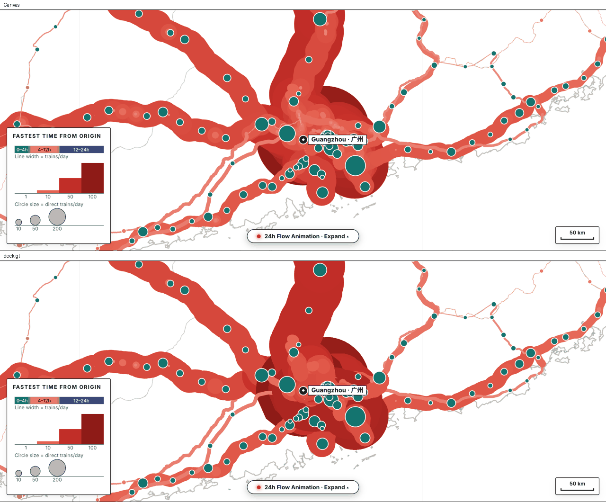
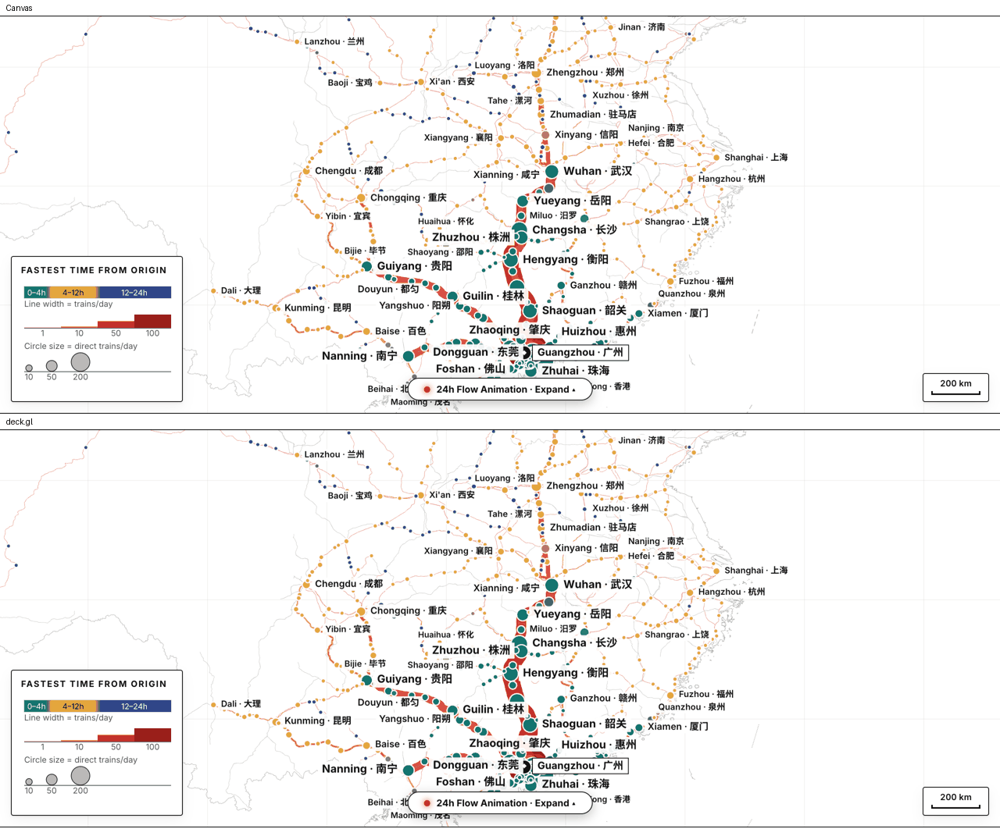
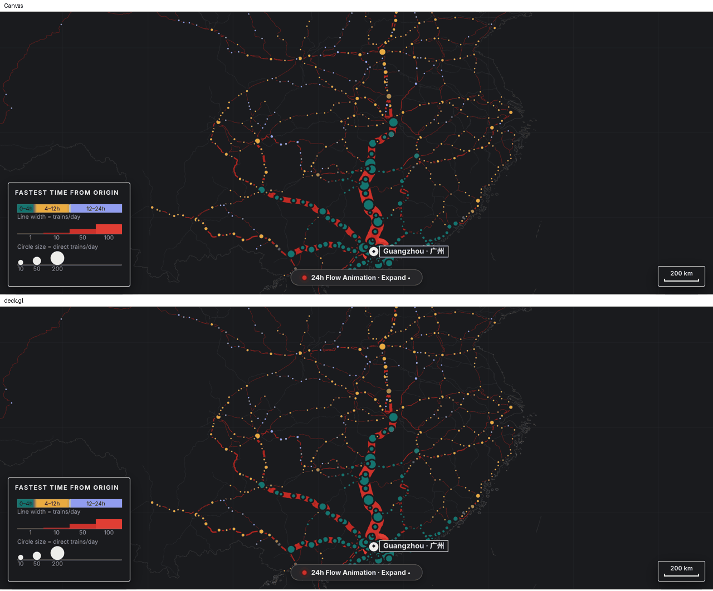
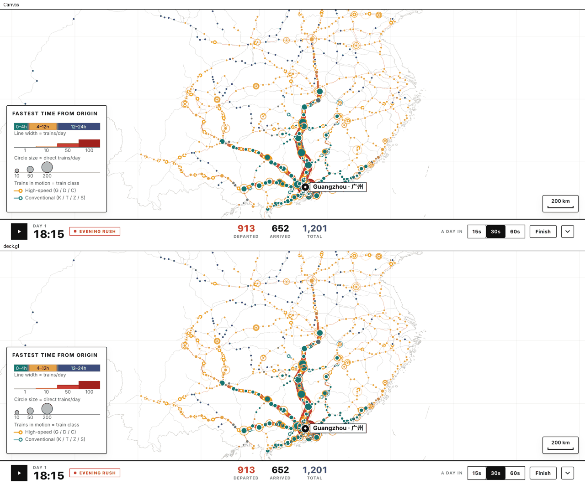

# deck.gl migration plan: from the Canvas 2D renderer to deck.gl

Status: **approved for execution, phase by phase, on the integration branch `deckgl`.**
**Gate G0: GO with conditions** (independent gate review 2026-10-25, §11.6; the conditions are
folded into the P1b tasks as C16–C26 below). Phase 1 is in progress: P1.0, P1.1, P1a.1–P1a.3 are
merged; P1b.1 is the next task.
Each phase is a set of numbered, PR-sized tasks with files, tests, acceptance numbers and a
stop/go gate. The owner decisions D1–D16 (§10) are **adopted defaults**: implementers follow
them unless the owner overrides one in writing.
Baseline: the review measurements were taken at `origin/main` @ `05bea87`; the integration
branch **`deckgl` exists at `cecf4d2`** (= current `main`, which includes PR #23's pack
rebuild). Pack-dependent numbers quoted here (2,668 trains at 18:15, 62 tests, section counts)
are re-verified on the current pack in P0.1 and corrected in §11 if they moved. Target
library: **deck.gl 9.4.0** (npm `latest`, re-checked 2026-10-24) on **luma.gl 9.4.x**. Spike
reference: `spike/national-anim` @ `600b3de`.

**Order of work (owner rule):** the origin view must work on deck first, with the current
interface and behaviour intact; only then the national (whole-network) view. Phase 0 spikes
the **origin** view on deck; Phase 1 migrates the origin view; Phase 2 adds the national
animation (A); Phase 3 adds national flows (B, A+B).

**Branch rules (owner rule):**

- All deck.gl work lives on the long-lived integration branch **`deckgl`** (exists;
  `cecf4d2` = `main` at the time of writing). **Nothing from this plan lands on `main`
  directly**, including tooling.
- Every task PR targets **`deckgl`** (`gh pr create --base deckgl`). PR #24 (this plan) also
  targets `deckgl`.
- The renderer flip (P1c.1) and the Canvas deletion (P1c.2) happen on `deckgl` only.
- **`deckgl` → `main` is one explicit owner gate (G-MAIN, D16).** No agent opens or merges
  that PR; the owner does.
- `deckgl` takes `main` in by a "sync PR" (`git merge main` into `deckgl`) at least weekly
  and before every parity run. The sync PR author runs
  `git diff <last-sync>..main -- web/src/components/map web/src/components/MapCanvas.tsx`
  and mirrors any Canvas-side change into `lib/mapModel.ts` / the deck layers in the same
  PR, so parity never silently drifts (R10).
- Spike branches (`spike/deckgl`) fork from `deckgl` and are never merged.

Where this plan states a number, the source is given: **[measured]** means measured for
this plan or in the spike, **[source]** means read from the deck.gl 9.4.0 package source,
**[docs]** means read from deck.gl's published 9.x API reference, and **[estimate]** means
a guess that Phase 0 must replace with a measurement.

---

## Review changes (2026-10-24, second pass against the code and the deck.gl docs; third pass for the owner's reorder)

What changed and why. Everything below is folded into the sections.

| # | Finding | Change |
|---|---|---|
| C1 | **`LineLayer` has no `getSourceColor`/`getTargetColor`** (only `getColor`) **[docs]**. The gradient-tail plan was wrong. | Tails are a `TailLayer extends LineLayer` (~15 lines: `getShaders()` injects `vColor.a *= positions.x`, fading source→target). Phase 0 M13 verifies; fallback `ArcLayer({getHeight: 0, numSegments: 2})` (has per-end colours **[docs]**), last resort a solid tail at α 0.6 (visible change, owner notified). |
| C2 | Dot "stroke trick" numbers were inconsistent. ~~`ScatterplotLayer` draws the stroke **inside** the radius~~ — **wrong, superseded by C17**: the stroke is centred on the radius. | ~~`getRadius: 4`~~ → `getRadius: 3`, `getLineWidth: 2` (C17). |
| C3 | "A section with `n = 0` gets width 0" would be re-grown to 0.5 px by `widthMinPixels`. | Visibility of `n = 0` sections via `DataFilterExtension` (`getFilterValue = n`, `filterRange [0.5, 1e9]`), never via width. |
| C4 | `staleReload.ts` matches only hashed `.json.br` 404s; a lazily imported deck chunk that 404s after a deploy is an `import()` TypeError with no status, so an old tab would never self-heal. | New pure `importFailureDecision()` + `maybeReloadForFailedImport()` with the same 60 s cooldown; tests in `staleReload.test.ts`; the deck loader calls it on rejection. |
| C5 | `"build": "node bundle.mjs"` runs under Node on Vercel and CI, so production already uses the **esbuild** branch; the `Bun.build` branch is dead for prod. | D14: esbuild is the one bundler; the Bun branch is deleted in P1.1. Concrete esbuild split options in §7 R2. |
| C6 | `draw(M)` and `resize(M)` are canvas-bound (`anim.ts`, `camera.ts`, `api.ts`, `pointer.ts` import `draw`; `resize` returns early without a `<canvas>`). | P1.0 adds `M.render()` to `MapCtx`; hosts set it. `resize()` measures `wrapRef` and sizes the 2D canvas only if present. The camera stays `S.current.view` for both renderers; conversion per view-state event (§5). |
| C7 | Phones cannot be an agent gate (no devices). `drv/nat2.mjs` launches `headless: true`, which can land on SwiftShader. | Phone checks are **owner steps**. The perf driver prints `UNMASKED_RENDERER_WEBGL` and **fails if it contains "SwiftShader"**; `--headed` rerun. |
| C8 | `gpuTimePerFrame` is disabled unless `deviceProps: {debugGPUTime: true}` **[docs]**. | Set in the perf harness only. |
| C9 | The `mapModel` extraction was right but one lump, and the zero-diff screenshot tooling it depends on did not exist. | Drivers land first (P0.1, on `deckgl`); the extraction is three zero-diff PRs (P1a.1 camera/ferry/tooltip, P1a.2 `mapModel` flows, P1a.3 stations/labels). |
| C10 | National mode semantics were undefined. | D13 defines national mode; `AnimState` gains `national`/`running`; two scrubber labels change (`TimelineScrubber.tsx`, previously claimed unchanged). |
| C11 | D8 relied on `navigator.deviceMemory`, absent in Safari. | D8: cap DPR at 2 in national mode on `deviceMemory ≤ 4` **or** any touch device. |
| C12 | Preserved behaviour rules lacked named checks. | §6.1 maps every rule to a test or acceptance check. |
| C13 | Verified and kept: projection formulas; `flowWidth` ↔ `widthUnits:'common'` + `widthMinPixels 0.5`; 62 tests / 7 files; 3,146 lines; bundle 392,735 B JS, `index.html` 454,611 B / 133,146 B gzip; deck.gl 9.4.0 = npm latest; `dashUnits:'pixels'` **[docs]**; DataFilter `filterSize ≤ 4`, 128 categories **[docs]**; `useDevicePixels` number **[docs]**; 8 MB ref estimate. TripsLayer GPU estimate tightened to ≈ 45–60 B/vertex. | — |
| C14 | `@deck.gl/react` vs imperative `Deck`: decided. | D15: imperative `Deck` driven from `MapCtx`; no `@deck.gl/react`. |
| C15 | **Owner feedback (third pass):** all work on the `deckgl` integration branch, never on `main`; origin-view compatibility first, national second; `deckgl` → `main` is an explicit owner gate. | Branch rules above; phases reordered (Phase 0 = origin spike with national numbers secondary; Phase 1 = origin migration incl. flip and Canvas deletion on `deckgl`; Phase 2 = national A; Phase 3 = B/A+B); task IDs and dependency graph rewritten; new D16 (merge timing); §2.5, §9, §11 re-cut to the new order. |
| **G0 gate review (fourth pass, 2026-10-25; spike `spike/deckgl` @ `f04acf8`, re-measured independently, §11.6)** | | |
| C16 | **M2's threshold was written as "≤ 33 ms" but means two vsync intervals at 60 Hz (33.3 ms)**; one of three reps landed exactly there and the p95 of a rAF-interval series can only take values near multiples of 16.7 ms. rAF intervals also degrade under machine contention while draw time stays flat (G8). | M2 threshold restated as **p95 rAF ≤ 33.4 ms (2 vsyncs) on the median of 3 reps, and draw+raster p95 ≤ 16.7 ms** (the contention-robust primary). Same restatement for M2n. The spike's M2 is a pass under both readings (median 16.8; draw+raster 11.9–13.9). |
| C17 | **C2 was wrong: `ScatterplotLayer` strokes are centred on `radius`** (`outerRadiusPixels = radius + lineWidth/2`, `innerUnitRadius = 1 − lineWidth/outer` in `scatterplot-layer-vertex.glsl` 9.4.0 **[source, re-read]**). | Rule: **`getRadius = outerEdge − lineWidth/2`**. Train dots `getRadius 3`, `getLineWidth 2` (ring 2–4 px, white core 0–2 px); isolated `4.15` / `2.7`; station dots `getRadius = r` (Canvas strokes are centred on `r` too), dwell ring `6.5`, rings at their centre-line radius. Rows 15–23 and P1b.3 corrected. |
| C18 | **`Deck.onError` never receives a context loss in 9.4.0**: `_onContextLost` is defined but has no caller **[source: `lib/deck.js`, grep of `@deck.gl/core/dist`]**; luma registers `webglcontextlost` without `preventDefault` (`create-browser-context.js`), so without our own listener the browser never fires `webglcontextrestored`. The M12 rewording is legitimate: the plan's intent (no crash, notice, map recovers) holds and was demonstrated. | R3 rewritten. **Context-loss recovery is an explicit P1b.1 task item** with acceptance: own `webglcontextlost` listener (`preventDefault`, notice shown, no `pageerror`), `webglcontextrestored` → `finalize()` + new `Deck` on a **fresh canvas element** exactly once, map redraws; if no restore within 5 s the notice offers tap-to-resume which does the same. M12 in the P0.2 table reworded. |
| C19 | **Flow draw order (G2) resolved: one binary `PathLayer` per pass with the geometry uploaded in `pass.items` order.** A binary PathLayer draws instances in path order and deck's defaults are `depthCompare 'less-equal'`, `depthWriteEnabled true` (`layers-pass.js`), so later paths win: path order **is** paint order. Canvas order is `pass.items` order (`flowPasses` sorts widest first, also per animation step, `mapModel.ts`). Measured: `PathTesselator` with `_pathType:'open'` takes **0.29 ms for the whole `sec` set** (7,922 sections, 75,044 vertices) and **0.25–0.33 ms** to copy + tesselate an origin's flow subset widest-first (广州 4,286 sections / 14,902 vertices; busiest 北京 5,195 / 18,200) **[measured, Bun, median of 9]**. The subset is 4–5× fewer vertices than the whole set, so per-step attribute work shrinks too. Width buckets (5 layers, 7.3 ms CPU, 31 MB) are rejected. | §2.2/§2.6/P1b.2 rewritten: a pass's `data` is a new binary object `{length, startIndices, attributes}` built from its `items` (n > 0 only, in items order) whenever the items identity changes (origin, direction, filter, selection, animation step); geometry for n = 0 is simply absent, so **`DataFilterExtension` is no longer used for flows** (C3 stays for infra categories only). Picking maps `info.index` back through the pass's `idx → s` array. Acceptance numbers in P1b.2. |
| C20 | **The G1 parity target (≤ 0.5 %) was at or under the anti-aliasing floor.** Reproduced the spike's M14 numbers to three decimals (deterministic). Under the plan's literal rule (pixelmatch threshold 0.1, `includeAA:false`) the AA-only scenarios sit at **0.16–0.56 %** (`infra-on` 0.56, `guangzhou-initial`/`inbound`/`class-filter-G` 0.48); `cmp.mjs --tolerance 25` is a stricter stand-in (0.75–1.9 %) because it counts AA pixels. Cause: 4× MSAA quantises hairline coverage (0.45–1.25 px network/infra, 1.5 px dot rings) to 25 % steps, up to 64/255 per pixel along whole lines, which Canvas's analytic AA does not. **[measured, §11.6]** | **G1 corrected (P1b.5):** `pixelmatch` semantics (threshold 0.1, AA pixels excluded) **≤ 1.0 %** per scenario; D3-affected four **≤ 2.0 %**; `labels-on` **≤ 1.5 %** (C21). `cmp.mjs` gains `--pixelmatch` (devDependency `pixelmatch`, zero deps; same PNG codec) in P1b.5 and keeps `--tolerance` for the old numbers. Structural sign-off stays: diff masks attached, every solid red region ≥ 8×8 px listed with a cause. |
| C21 | **Labels are placed identically but the glyphs are not pixel-identical**: text on the transparent overlay canvas is rasterised softer (grayscale AA, no opaque-background contrast boost) than on the opaque Canvas map; every label edge pixel differs, including the origin label in every scenario (`labels-on` 1.23 % under pixelmatch, 2.69 % raw). Invisible at 1× (side-by-side crop in §11.6). | §1.2 claim corrected to "identical placement; text AA softer". `labels-on` allowance in C20; the origin label's share (< 0.1 %) is inside the 1.0 %. The owner's M10 eyeball now decides whether the softer text is acceptable or `TextLayer`/DOM labels get a task. |
| C22 | **A new layer type's first frame may draw nothing** while luma compiles its pipeline asynchronously (G4); `deck.redraw()` and `setProps` are synchronous (G5). | P1b.1: `DeckHost` counts frames and exposes `window.__deckStats.{afterRenders, settled}`; "settled" = two consecutive `onAfterRender` with an unchanged layer-id set and no pending pipeline compiles. Drivers and tests wait for `settled`, never a fixed sleep. `M.render()` = `setProps({viewState, layers})` + `redraw('render')`, Canvas-identical timing. |
| C23 | **Two-pass bundling (P1.1) means the deck chunk is a separate module graph**: anything it imports from `src/` is duplicated, so module-level state is not shared with the entry, and a JSX `DeckHost` would bundle a second React (hooks from a second copy throw). The current lazy graph is 8 files, 219 KB brotli, no React **[measured, build of `deckgl` @ `b4cc2a1`]**. | `DeckHost.tsx` is an **imperative module**: `mountDeck(M: MapCtx, host: HTMLDivElement): DeckHandle` (`render`, `pick`, `pickMultiple`, `resize`, `destroy`); no React, no JSX, no imports of modules with module-level state (`map/camera.ts` timers, `map/render.ts`); everything comes in through `MapCtx`. `MapCanvas.tsx` mounts it from a `useEffect` after `loadDeck()` resolves (not `React.lazy`). `bundle.mjs` asserts **no `node_modules/react` input in the lazy graph** and that the entry references the chunk (already does). |
| C24 | **Keep our pointer handling; `controller: false`.** deck's wheel curve is logistic, `scale = 2/(1 + exp(−abs(δ·speed)))` with δ = −deltaY (`controller.js`, mjolnir) **[source]**, saturating at 2× per event, while ours is `exp(−deltaY·0.0016)`; a calibrated `speed ≈ 0.0033` matches within 1 % at deltaY = ±100 but 11 % at ±300. The spike kept `pointer.ts` + the existing wheel listener with `controller: false` and the whole interaction stack worked. | New **D17**: `pointer.ts`, the wheel listener and `camera.ts zoomAt` stay for both renderers; the deck canvas has `pointer-events: none` under the existing pointer-capturing element. R8 (feel) disappears; the P1b.1 wheel calibration check is dropped; P1b.4 implements `pick()` on deck's `pickObject`/`pickMultipleObjects` from our handlers (no `onHover`/`onClick`); P1c.2 no longer deletes `pointer.ts`/the wheel code. Rows 27–28 updated. |
| C25 | M14 methodology checked: `cmp.mjs` counts a pixel as differing when any channel differs by > 25; pixelmatch 0.1 is ≈ 26/255 for achromatic deltas (YIQ metric) **and** skips AA pixels by default, so the stand-in was stricter, not looser. Verified by re-running both on the same shots. | No change to M14's verdict; the comparison rule for G1 is fixed by C20. |
| C26 | Settled during the review, recorded so nobody re-derives them: `deck.metrics.gpuMemory` agrees with the attribute-buffer sum (G6); `preserveDrawingBuffer` is true by default so `readPixels` after `redraw()` works (used by M9/M12/M13 probes); interleaved `stride/offset` attributes (§2.2) were not exercised (G7) and stay optional. | §2.2 wording. |

---

## 0. TL;DR

- **The camera maps exactly onto deck.gl.** `camera.ts` uses `px = lon·scale + tx`,
  `py = −lat·scale + ty`. That equals `OrthographicView({flipY: false})` with positions
  `[lon, lat]`, `zoom = log2(scale)` and `target = [(W/2 − tx)/scale, (ty − H/2)/scale, 0]`.
  Checked in Node and Bun against `@deck.gl/core` 9.4.0 `OrthographicViewport.project`:
  largest error 4.6e-13 px **[measured]**. `flipY: false` so no coordinate is negated.
- **The bundle grows less than feared, and it is split out.** Core plus Path/Scatterplot
  layers minify to 833 KB (234 KB gzip); the full set (Trips, Text, Line, DataFilter,
  PathStyle) is 949 KB minified, 262 KB gzip, 217 KB brotli **[measured, esbuild 0.28.2]**.
  Today's app JS is 392,735 B minified; `index.html` is 454,611 B (133,146 B gzip)
  **[measured]**. deck ships as a **hashed, immutable, lazily imported ESM chunk** under
  `assets/`; `index.html` stays the revalidated entry. (Once deck is the default renderer the
  chunk is fetched on first paint, so the lazy load buys little on the origin view; it still
  keeps `index.html` small and immutable-cached deck bytes across deploys.)
- **Origin view first.** Phase 0 spikes the origin view on deck (flows, stations, trains,
  picking, labels overlay) and measures parity against the committed screenshots; the
  national peak numbers are collected as secondary information for Phase 2's gate.
- **Most of the complexity is semantics, not drawing.** `flows.ts` (853 lines) is mostly
  "which sections, at what alpha and width, under which selection / animation / isolation
  state". That moves to pure, tested `lib/` functions **before** any deck layer is written
  (Phase 1a, zero screenshot diff), so a semantic rule lands once and both renderers consume it.
- **The spike's 16.6 ms Canvas cost (national) comes from the tails, not the position maths.**
  On deck the dots are one `ScatterplotLayer`, the tails one `TailLayer` (C1), both reading an
  interleaved `Float32Array` as binary attributes. Expected CPU per frame well under 2 ms
  **[estimate]**. TripsLayer stays optional (180–400 MB GPU without simplification).
- **Coexistence is a switch, not a stack.** On `deckgl`, `?renderer=deck` selects the deck
  origin renderer (P1b); the flip makes it the default (P1c.1); Canvas is deleted (P1c.2).
  Both renderers share `MapCtx` (camera `S.current.view`, animation clock, tooltip and
  scale-bar DOM); only `M.render()` differs.
- **Labels stay off-deck** on a thin overlay canvas drawn in `onAfterRender` (D5).
- **Effort.** Phase 0: 1.5–2.5 days. Phase 1: 10–14 days. Phase 2: 4–6 days. Phase 3: 3–5
  days of web work plus the pipeline task.

---

## 1. Current client inventory (what has to be replaced)

`web/src/components/map/` is **3,146 lines** across 11 modules **[measured]**, all imperative
Canvas 2D driven from one `draw(M)` in `render.ts`. Paint order: backdrop → chords → flows →
infra → trains → hover segment highlight → stations → labels → legend sync → scale bar.

| # | Visual element / behaviour | Where today | deck.gl target | Notes |
|---|---|---|---|---|
| 1 | Paper background | `backdrop.ts paintBackdrop` | CSS `background` on `#map` host + transparent deck canvas | No layer |
| 2 | Country outline rings (fill + stroke) | `backdrop.ts drawOutline` | `SolidPolygonLayer` (fill) + `PathLayer` (stroke) | Width `max(0.65, scale·0.015)` → `widthUnits:'common'`, `getWidth 0.015`, `widthMinPixels 0.65` |
| 3 | Open boundary lines, nine-dash line | `drawOutline` (lines with `len ≤ 4` dashed) | `PathLayer` + `PathStyleExtension({dash:true})`, `dashUnits:'pixels'` **[docs]** | Dash `[max(6,2.2w), max(4,1.8w)]` |
| 4 | Graticule (5°) | `drawGraticule`, rebuilt per view | Static `LineLayer`, lon 60–150 / lat 0–60, 0.5 px | No per-view rebuild |
| 5 | Base network | `drawNetwork` | `PathLayer` on `atlas.net` (binary, `startIndices`, `_pathType:'open'`); `common` width 0.008, `widthMinPixels 0.45`, `widthMaxPixels 2.5` | One-to-one clamp mapping |
| 6 | Qiongzhou ferry (dashed blue, water part only) | `isFerry` bbox test + `traceInto(..., "landOnly"/"waterOnly")` **re-split every frame**; bbox test duplicated 6× | Split once at decode in `lib/ferry.ts`; water pieces → dashed `PathLayer` | — |
| 7 | Backdrop offscreen cache | `drawBackdrop` + `BackdropCache` | **Deleted** | GPU redraw is cheap |
| 8 | Routed flows: width ∝ trains, colour ramp, **widest first** | `flows.ts drawFlows / strokeFlowList` (0.25 px buckets, `pass.items` order) | One binary `PathLayer` per pass, geometry uploaded **in `pass.items` order** (n > 0 only, C19); `getWidth = n·WIDTH_K/fitScale`, `widthUnits:'common'`, `widthMinPixels 0.5`; `getColor` = `flowColorRGBA` | Equals `flowWidth(n, scale, fitScale) = max(0.5, n·0.08·scale/fitScale)` exactly **[verified]**; pan/zoom cost zero attribute updates; path order = paint order (C19). `n = 0` sections are absent from the pass data (no `DataFilterExtension` for flows) |
| 9 | Flow dimming passes (selected city, filtered view, isolated train) | `drawFlows` branches, faded α 0.06/0.08 (iso) and 0.16/0.18 (dark/light) | Two `PathLayer` instances: `flows-context` (faded, `pickable:false`) and `flows-focus` | D3: context pass pre-blended opaque |
| 10 | Animated flow growth (`secFlowSteps`) | `drawFlows` (`step = floor(t/stepMins)`) | `updateTriggers: {getWidth: step, getColor: step}` | Once per 5-min step |
| 11 | Isolated-train corridor (progressive) | `drawFlows` iso branch + `tracePartialSec` | `PathLayer` with one path from `lib/mapModel.ts isolatedCorridor` | Per frame, one path |
| 12 | Infrastructure overlay | `drawInfra` | `PathLayer` 1.25 px, colour by `hsr[s]`; connected/unconnected via `DataFilterExtension` categories | — |
| 13 | Chord legs (dashed straight) | `drawChords`, gated by first departure | `PathLayer` + `PathStyleExtension`, `dashUnits:'pixels'` | Gating → `lib/mapModel.ts chordVisibility` |
| 14 | Hover highlight (seg/chord), width +1.6 | `drawHighlightSeg` | `PathLayer` with 0–1 items | — |
| 15 | Station dots: `stationR·stationZoomK(t)`, `rampColor(fastest)`, `dotEdge` stroke 1.5/3.0 | `stations.ts drawStations` | `ScatterplotLayer`, `radiusUnits:'pixels'`, `stroked`, `lineWidthUnits:'pixels'`, `getRadius = r` (stroke centred on `r` in both renderers, C17) | `updateTriggers.getRadius = round(stationT, 3)` |
| 16 | Dot growth while animating | `drawDot` (`cityArrTimes ≤ t`) | Same `lib` maths; `getRadius` trigger on `animTime` | ≤ 300 points |
| 17 | Arrival ripple (gold ring, 20 min) | `drawDot recentArrival` | `ScatterplotLayer filled:false`, per-point radius/alpha | Exact |
| 18 | Selected / hovered rings, origin hover ring | end of `drawStations` | `ScatterplotLayer` (0–3 points) | — |
| 19 | Origin marker (disc + diamond) | `drawStations` | Disc: `ScatterplotLayer`; diamond: label overlay canvas | Avoids an `IconLayer` atlas |
| 20 | Train dots: glow r4 + white core r2, α 0.45 on chords | `trains.ts drawTrains` | One `ScatterplotLayer`: **`getRadius 3`, `getLineWidth 2`** (stroke centred: ring 2–4 px, white core 0–2 px; isolated `4.15`/`2.7`), `getFillColor` white, `stroked`, `getLineColor` class colour (C17) | One draw call |
| 21 | Gradient tails 12 px × speedFrac (22 isolated), width 2.5 (3.5) | `drawTrains` (save/rotate/stroke per train) | `TailLayer` (C1): source = pos − heading·len/scale, colour fades to α 0 at the source | Length ∝ 1/scale so it stays 12 px |
| 22 | Dwell ring (r 6.5, α 0.85, 1.3 px) | `drawTrains` | `ScatterplotLayer` stroked-only on dwelling dots, `getRadius 6.5` (centre line), `getLineWidth 1.3` | — |
| 23 | Hover/selected/isolated train ring + code tag | `drawTrains` | Ring: `ScatterplotLayer` (0–2) at the Canvas centre-line radius. Tag: label overlay canvas | — |
| 24 | City labels (collision-aware, tiers by zoom, boxed origin/selected) | `stations.ts drawLabels` (≈ 250 lines) | Placement → pure `lib/labels.ts`; drawing → overlay canvas (placement identical; glyph AA softer on the transparent overlay, C21) | §1.2 |
| 25 | Hover tooltip (HTML) | `interaction.ts showTooltip` (≈ 190 lines) | **Unchanged** DOM `#tooltip`; builders → `lib/tooltip.ts` | Positioned from the pointer as today |
| 26 | Hit-testing: train (14 px, paused only) > station (`14·zoomK`) / origin (15 px, wins ties) > segment (10 px, busier wins within ±0.75 px) > chord | `interaction.ts pick*` | `interaction.ts pick()` calls `DeckHandle.pick`/`pickMultiple` (deck GPU picking) + pure `lib/pick.ts pickPriority` (D6), P1b.4 | §2.5 |
| 27 | Tap-select / tap-empty-clears / pinned tooltip | `pointer.ts endPointer` | **Unchanged** (`pointer.ts` stays, D17/C24); `endPointer` calls the same `pick()` | P1b.4 driver checks tap semantics |
| 28 | Pan / wheel / pinch, clamp `fitScale·[0.55, 60]` | `pointer.ts`, `camera.ts zoomAt`, wheel listener in `MapCanvas.tsx` | **Unchanged**: `controller: false`; the deck canvas is `pointer-events: none` under the pointer-capturing overlay canvas (D17/C24). The deck `viewState` is derived from `S.current.view` on every `M.render()` | No calibration needed; deck's own wheel curve is logistic and would not match (C24) |
| 29 | Fit country / home / Guangzhou initial / `panZoomTo` / `initialCamera` / keep centre on resize | `camera.ts fit*`, `resize` | Same maths on `S.current.view`; `lib/camera.ts` converts to/from `viewState` | `MapApi` unchanged |
| 30 | Scale bar | `camera.ts updateScaleBar` | Unchanged; called from `M.render()` | — |
| 31 | URL view report (debounced) | `reportViewChange` | Unchanged; URL zoom `log2(scale·360/256)` kept | — |
| 32 | Day / night | `lib/palette.ts palette(dark)` | Add RGBA tuple variants; `dark` in colour triggers | Strings stay for DOM/Legend |
| 33 | DPR cap 3 | `resize` | `useDevicePixels: Math.min(3, devicePixelRatio)` (cap 2 per D8 in national mode) | — |
| 34 | Origin-switch fade (`#map.switching`) | `MapCanvas.tsx` | Same class on the deck host `div#map` | — |
| 35 | Legend sync | `render.ts` | From `M.render()` | SVG, stays |
| 36 | Animation clock | `anim.ts` | **Kept**; calls `M.render()` | Scrubber/modal subscribe unchanged (Phase 2 adds two labels, C10) |
| 37 | Loading / error / stale overlay, isolation chip, timeline button | `MapCanvas.tsx`, `MapOverlays.tsx` | **Unchanged** | — |

Everything outside `components/map/` and `MapCanvas.tsx` stays unchanged except the small,
named edits in the task lists (`App.tsx`, `Toolbar.tsx`, `TimelineScrubber.tsx`,
`useUrlState.ts`, `useAtlasData.ts`, `bundle.mjs`, `index.template.html`, `staleReload.ts`).
**The `MapApi` interface in `context.ts` is the seam**; it does not change.

### 1.1 Target module layout (after Phase 1c)

```
web/src/lib/               (pure, bun-testable; no deck imports)
  camera.ts      View {scale,tx,ty} <-> viewState {target,zoom}; fit maths; zoom clamps; scale-bar distance
  mapModel.ts    flow passes for every selection/animation/isolation state; chord gating; station
                 states (radius inputs, ripple, alpha); isolatedCorridor; selection cache rule
                 (getSelCache / isTrainShown, moved from map/trains.ts; delegates to stopEffects)
  labels.ts      label candidates + collision placement (from drawLabels; returns boxes + text)
  tooltip.ts     tooltip HTML builders (from interaction.ts)
  ferry.ts       one-time land/water split of the ferry sections
  pick.ts        pickPriority(candidates, px, py, project)
  national.ts    (Phase 2) national per-train timelines on section refs
  (unchanged)    decode, filter, origin, timeline(+prepTrainPath in Phase 2), stopEffects, palette(+RGBA), format, geo
web/src/components/map/
  deck/DeckHost.ts           mountDeck(M, host) → DeckHandle: Deck instance (controller: false), lifecycle,
                             context loss, settled-frame counter, onAfterRender → overlay. Imperative, no React (C23)
  deck/TailLayer.ts          LineLayer subclass with the source→target alpha fade (C1)
  deck/layers/{backdrop,flows,stations,trains}.ts   props builders only (pure given inputs)
  deck/layers/national.ts    (Phase 2)
  deck/labelsOverlay.ts      thin 2D canvas: labels, origin diamond, train tag (also the pointer-capturing element)
  deck/load.ts               lazy import() of the deck chunk + stale-chunk recovery (C4)
  anim.ts, api.ts, camera.ts, context.ts, pointer.ts   kept (camera.ts shrinks to resize/report glue;
                             pointer.ts and the wheel listener serve both renderers, D17)
```

Everything under `deck/` is bundled as the lazy chunk by a **separate esbuild pass** (P1.1):
it may import pure `lib/*` and types freely (they are duplicated into the chunk), but it must
not import a module whose module-level state the entry also uses (`map/camera.ts` timers,
`map/render.ts`, `map/anim.ts`), must not import React, and gets everything it needs through
`MapCtx` (C23).

### 1.2 Why labels stay outside deck (D5 adopted: overlay canvas)

| Option | Pros | Cons |
|---|---|---|
| **Overlay 2D canvas (adopted)** | Same text engine as today (native CJK shaping, system font fallback); identical placement; ≈ 40 lines of drawing | One extra canvas; redraw on every deck frame (≤ ≈ 60 labels, cheap). **Glyphs are not pixel-identical**: on a transparent canvas Chrome rasterises text with plain grayscale AA, softer than on the opaque map canvas (C21, crop in §11.6); invisible at 1×, but every glyph edge pixel differs |
| `TextLayer` (`characterSet:'auto'`, `background:true`) **[source]** | All on GPU | SDF text at 10.5–14 px is softer than native, especially thin CJK strokes; atlas rebuilds on new characters; collision still JS |
| DOM labels | Crisp; screen-reader accessible | ≈ 60 elements repositioned per pan frame; z-order vs tooltip; collision still JS |

**Sync rule.** The overlay is drawn inside deck's `onAfterRender` with the viewport from
`deck.getViewports()[0]`, so it uses the exact view state of the frame just drawn (controller
inertia and controlled `viewState` updates both pass through a deck redraw). The overlay
canvas mirrors the deck canvas size (W × H CSS px, same DPR) and has `pointer-events: none`;
it sits above the deck canvas and below `#tooltip`.

---

## 2. Data flow: pack to layers

Pack format evolution beyond fmt 6 (manifest, binary columnar, what the client may compute): `docs/THIN_CLIENT.md`.

### 2.1 What the pack provides (fmt 6, `lib/decode.ts DATA_FMT = 6`)

| Pack (size, br) | Decoded into | Used by |
|---|---|---|
| `atlas-v2-shared` (529 KB) | `DecodedAtlas.sec / inSec / net / thr` (`DecodedSet`: `pts` Float32 lon/lat, `off`, `len`, `bb`, `hsr`) | All path layers; **geometry uploaded once per set** as binary paths (`startIndices = off/2`) |
| `atlas-v2-out-map` / `in-map` (546 / 551 KB) | `OriginVM.flows / inFlows / chords / dests / srcs` | Flow widths/colours, chords, station dots |
| `atlas-v2-out-tables` (1,650 KB: `paths`, `stop_pos`, `chords`, per-origin `dep_off`) | `expandOutTables` → `DepVM.secs / path / stopPos / chordLegs` | Origin timeline; **national timelines** (Phase 2 retains the raw `paths`/`stop_pos`/`chords` in `useAtlasData`) |
| `atlas-v2-in-tables` (1,796 KB) | `ArrVM` rows | Inbound panels/flows |
| `atlas-v2-schedules` (416 KB) | `DecodedAtlas.schedules` | Dwells; national stops (already fetched together with out-tables) |

`lib/` changes are additive only: `palette.ts` RGBA helpers; `camera.ts`, `mapModel.ts`,
`labels.ts`, `tooltip.ts`, `ferry.ts`, `pick.ts` extracted (Phase 1); `national.ts` and
`timeline.ts prepTrainPath` (Phase 2). `filter.ts`, `origin.ts`, `stopEffects.ts`,
`decode.ts` stay byte-for-byte unchanged, so the 62 existing tests keep guarding semantics.

### 2.2 Layer data shapes

- **Whole-set static geometry (infra, network, outline).** One binary `PathLayer` data object
  per `DecodedSet`: `data: {length: nSec, startIndices, attributes: {getPath: {value: set.pts, size: 2}}}`,
  `_pathType: 'open'` (skips normalisation **[docs]**). Per-section colour via accessors
  `(_, {index}) => colArr[index]` with `updateTriggers`; infra connected/unconnected via
  `DataFilterExtension` categories (C3). Geometry never re-uploads.
- **Flow passes (C19).** One binary `PathLayer` per `flowPasses` pass whose `data` is built
  from `pass.items` **in items order, n > 0 only**: `pts` = the concatenated section vertices
  (`Float32Array.set` of `set.pts.subarray(off[s], off[s] + 2·len[s])`), `startIndices`,
  parallel `Float32Array n`, `Uint8Array rgba`, `Int32Array idxToSec`; `_pathType: 'open'`.
  Path order is paint order, so this reproduces Canvas's widest-first overdraw exactly. A new
  `data` object is built when the pass's items identity changes (origin, direction, filter,
  selection, animation step): deck then recomputes that layer's attributes in O(vertices of
  the subset) (广州: 14,902 vertices; the whole set is 75,044) and re-uploads ≈ 0.4 MB.
  Tesselation of the subset is 0.25–0.33 ms **[measured]**; the attribute pass is what the
  spike already paid per step on the whole set (cpuTimePerFrame 2.4–3.5 ms), now 4–5× smaller.
  `n = 0` sections are simply absent (no `DataFilterExtension`, no `widthMinPixels` re-growth).
- **Animated dots (origin and national).** CPU writes an interleaved `Float32Array`
  (6 floats per dot: lon, lat, ux, uy, speed, flags). `getPosition: {value: buf, size: 2, stride: 24, offset: 0}`;
  colour from a parallel `Uint8Array(c·4)` filled in the same loop. A **new** `data` object
  `{length: c, attributes}` per frame (deck recalculates that layer's attributes when `data`
  changes **[docs]**; for external typed arrays that is a re-upload of ≈ c × 28 B).
- **Tails.** `Float32Array(c·4)` (source xy, target xy) in the same loop → `TailLayer`. The
  spike used separate (non-interleaved) arrays; `stride/offset` interleaving is an optional
  optimisation, not a requirement (C26).
- **Small per-frame sets** (ripples, dwell rings, highlight rings, isolated corridor): plain
  arrays (≤ a few hundred items).

### 2.3 National timelines and memory (A, Phase 2)

The spike (`lib/national.ts buildNational`) expands every train's path into its own vertex
arrays: **3.97 M vertices ≈ 48 MB** CPU, against **≈ 691 K section refs** **[measured, spike]**.
At ≈ 12k trains: ≈ 6.8 M vertices ≈ 82 MB **[estimate, linear]**.

**Dedup (P2.1).** Keep per-train **section refs plus cumulative starts**, like the origin
`PrepTrain` (`secStarts`, `throatSpans`, `chordSpans`). Position-at-distance = binary-search
the path entry, then binary-search inside the shared section's `secCumLens`
(`getSecGeometry` in `timeline.ts` already caches these per `DecodedSet`). Memory
≈ 691 K × (4 B id + 8 B start) ≈ **8 MB** plus the already-loaded geometry. Per frame: two
binary searches per active train (≤ ≈ 4.5k at 12k) **[estimate: < 1 ms]**.

Concretely: generalise `buildDayTimeline`'s per-train prep (`timeline.ts` lines ≈ 246–400)
into an exported `prepTrainPath(pathEntries, stopPos, chordLegs, atlas)` used by both the
origin timeline and `national.ts`. This is the only change to `timeline.ts`; the snapshot
tests (`tests/__snapshots__`) pin its output.

**Wrap-around (dots).** Keep the spike's rule: a train is drawn at display minute `m` for
every `k` with `start ≤ m + 1440k ≤ end` (`natPositions`). Handles overnight and multi-day
trains; a run longer than 24 h yields two dots.

**Synthetic load.** `?natSynth=12000` duplicates trains with a +37 min shift until
`n ≈ 12,000` (perf runs only; never on by default).

### 2.4 TripsLayer (optional comet mode; after Phase 2, only if M4n passes)

TripsLayer 9.4.0 (`@deck.gl/geo-layers`) **[source, docs]**: `getPath`/`getTimestamps` per
vertex; `currentTime`/`trailLength` in the timestamp unit (minutes); `fadeTrail` default
true; fragments outside `[currentTime − trailLength, currentTime]` are discarded; **draws only
the trail, never a head**; timestamps are float32 (minutes up to 4,320 → resolution ≈ 5e-4).

Timestamps from `prepTrainPath`: per vertex `timeAtDist(cumDist[v])`; dwells as a duplicate
vertex (`arrMins`, then `depMins`) offset ≈ 1e-6° to avoid a zero-length segment (M11 checks
the tesselator keeps it); wrap-around via shifted copies (timestamps − 1440·k) for trains with
`end > 1440` only.

Memory is the blocker: PathLayer-family positions are fp64 in `DEFAULT`/`LNGLAT`/`CARTESIAN`
coordinate systems **[source: `use64bitPositions`]**, uploaded as high+low float32 (24 B per
vertex), plus timestamps (8), colour (4), width (4), type (1), picking (3): ≈ 45–60 B/vertex
GPU plus a CPU staging copy. 3.97 M ≈ 180–240 MB; 6.8 M ≈ 300–400 MB. Only viable with
Douglas–Peucker simplification (≈ 0.005°, sub-pixel below ≈ 200 px/°), expected 5–10× fewer
vertices **[estimate]**, which Phase 0 M4n measures if time allows.

### 2.5 Picking

| Target | Phase 1 (origin view) | Phase 2 (national) |
|---|---|---|
| Train dots | `interaction.ts pick()` (called from our `pointer.ts`/hover handlers as today, D17) → `DeckHandle.pick({x, y, radius: 14, layerIds: ['trains']})` when paused; `info.index` → slot in the frame buffer → train | Same |
| Stations / origin | `DeckHandle.pickMultiple({x, y, radius: 15, depth: 10, layerIds: ['stations', 'origin']})`; radius rule (`14·zoomK`, origin 15 px, origin wins ties) applied in `pickPriority` | — (D13: no station dots in national mode) |
| Sections / chords | D6: candidates from `pickMultiple` on the flow/chord layers; `lib/pick.ts pickPriority` recomputes the exact screen distance (`distToSeg` over the ≤ 10 candidates' polylines via `M.X/M.Y`) and applies today's order and the ±0.75 px "busier section wins" tie-break; `info.index` maps to a section through the pass's `idxToSec` (C19). `flows-context` is `pickable: false` (today a filtered-out section is not pickable either) | Phase 3 (B) |

Picking only sees what the layers hold: today's gating ("not pickable unless active at
`animTime`", destination subset, isolated reached sections) falls away because each layer's
data **is** the visible set.

### 2.6 Update strategy

| Change | Layers touched | Mechanism |
|---|---|---|
| Pan / zoom | none, or `stations` (radius via `stationT`), overlay, tails (length ∝ 1/scale) | `viewState` only; `updateTriggers.getRadius = round(stationT, 3)` |
| Animation frame | dots, tails, dwell rings, ripples, station growth, isolated corridor | New binary attributes per frame; everything else memoised |
| Animation step (5 min) | flow passes (items re-sorted widest first by `flowPasses`) | New ordered pass `data` (C19), keyed on the pass's items identity |
| Origin / direction | all but backdrop | `cur` identity is the trigger key; flow passes rebuilt (C19) |
| Class / histogram / train filter (new `cur`) | flows (context + focus), chords, stations, dots | `cur` identity; `isFilteredView` → `mapModel` |
| Selected city / isolated train | flows-focus, infra, stations, dots | Rebuild focus data; `trainShownAt`/`stopArrivalTimes` (`lib/stopEffects.ts`) remain the single visibility rule |
| Theme | all colours | `dark` in every colour trigger |

**`DataFilterExtension`** (9.4: `filterSize ≤ 4`, `filterSoftRange`, categories: 128 at
`categorySize 1`, `countItems`) **[docs]** is used only where geometry is static and only
visibility changes: infra connected/unconnected; optional national dot class toggle; Phase 3
"hide B below threshold". Not for flows (their pass data already omits `n = 0`, C19) and never
for widths (class filters change `n`).

---

## 3. Visual parity

| Element | Expected difference | Resolution | Decision |
|---|---|---|---|
| Faded flow passes (α 0.06–0.18) | Canvas strokes one bucket path at a time (no alpha build-up within a bucket); deck blends each path, so overlaps get darker | Context pass **opaque, pre-blended** against `pal.paper`: `mix(col, paper, 1−α)`. The network no longer shows through faded flows | **D3 adopted** |
| Joints / caps | `jointRounded: true, capRounded: true` ≈ Canvas round | — | No |
| Flow overdraw order | Canvas strokes `pass.items` widest first; a binary PathLayer draws in path order | Geometry uploaded per pass in items order (C19); the spike's single index-ordered layer showed 3.35 % on `city-zoom-x10` | No |
| Width quantisation | Canvas rounds to 0.25 px; deck continuous | None | No |
| Gradient tails | `TailLayer` fades alpha linearly source→target in the shader; Canvas used a premultiplied gradient to transparent white | Source colour = class colour at α 0 (no whitish fringe); `LineLayer` has no round cap but the cap sits under the head | No (M13 screenshot) |
| Comet mode | Track-following trail in minutes | Only if D2 toggled on later | D2 |
| Dots | Crisp antialiased ring vs Canvas arcs: same | — | No |
| Ripples / dwell rings | Exact | — | No |
| Dashes | `PathStyleExtension` restarts per path like `setLineDash` per stroke; `dashJustified: false` | `dashUnits: 'pixels'` | No |
| Labels | Identical placement; glyph AA softer on the transparent overlay (C21) | `labels-on` has its own G1 allowance; owner M10 eyeball decides whether it matters | D5, M10 |
| Antialiasing | 4× MSAA quantises hairline coverage to 25 % steps (up to 64/255 per pixel along 0.45–1.5 px lines and rings); Canvas AA is analytic. This is the parity floor: 0.16–0.56 % per scenario under pixelmatch (AA pixels excluded), 0.75–1.9 % raw **[measured]**; 0.45–0.5 px floors may shimmer | G1 thresholds set above the floor (C20); raise widths to 0.6 if the screenshot review shows shimmer | Screenshot review |

---

## 4. Phases and tasks

Conventions for every task: one PR per task unless marked "same PR", **base branch `deckgl`**;
`bun run typecheck`, `bun run build` and `bun test` green; **no `test.skip`/`.only`/TODO
stubs**; the PR description quotes the acceptance numbers it measured. "Parallel" means the
task touches no file another in-flight task touches. Tasks marked **[owner]** are performed
by the owner, reported in §11, and never block agent tasks unless stated. "Baseline shots"
means the 28 PNGs produced by building `deckgl` at the merge-base of the PR (the Canvas
renderer) with `web/tools/shots/`.

### Phase 0: tooling + origin-view spike on deck (1.5–2.5 days). Go / no-go gate

**P0.0 Integration branch** — done: `origin/deckgl` exists at `cecf4d2` and PR #24 targets
it. Each agent starts a task with `git fetch origin && git checkout -b <task> origin/deckgl`
and verifies `git merge-base --is-ancestor origin/main origin/deckgl` (if not, a sync PR comes
first). Sequential first.

**P0.1 Commit the measurement drivers (PR → `deckgl`)** — *sequential after P0.0; everything else waits on it.*
Files: new `web/tools/shots/shots.mjs`, `web/tools/shots/cmp.mjs` (pixelmatch-style diff,
ported from scratchpad `drv/shots.mjs`, `clsshots.mjs`, `hcshots.mjs`, `minshots.mjs`,
`cmp.py`), new `web/tools/perf/origin.mjs` and `web/tools/perf/national.mjs` (from
`drv/nat2.mjs`/`perf.mjs`), `web/tools/serve.mjs` (static `dist/` server with a `--404 <path>`
flag for the stale-chunk check), `web/package.json` (`devDependencies`: `puppeteer-core`;
scripts `shots`, `perf`), `web/src/App.tsx` (expose `window.__M` next to the existing
`window.__mapApi` debug handle). Scenarios in `shots.mjs` (each a named step and a PNG):
`national-fit`, `guangzhou-initial`, `city-zoom-x10`, `selected-city`,
`selected-city-minimized`, `isolated-train-mid`, `class-filter-G`, `inbound`, `infra-on`,
`night`, `anim-0600`, `anim-1815`, `anim-2350`, `labels-on`, at DPR 1 and 2 (28 PNGs).
Perf drivers print `UNMASKED_RENDERER_WEBGL` and **exit non-zero if it contains
"SwiftShader"** (C7); `--headed` relaunches with `headless: false`. `origin.mjs` plays the
origin animation on 广州 and sweeps `animTime` 360 → 1440 in 0.5-min steps for 300 frames.
Tests: none (tooling). Acceptance: `bun run shots -- http://localhost:8766 out/` writes 28
PNGs; `cmp.mjs a/ b/ --max 0.5` prints per-scenario mismatch % and exits 1 above the threshold.

**P0.2 Spike branch `spike/deckgl` (forked from `deckgl`, never merged)** — *sequential after P0.1.*
Files: `web/package.json` (add `@deck.gl/core`, `@deck.gl/layers`, `@deck.gl/extensions`,
`@deck.gl/geo-layers` at exact `9.4.0`), a throwaway deck host behind `?renderer=deck` that
draws the **origin view**: backdrop (outline, graticule, network), flows (binary `PathLayer`
with per-section width/colour from `cur.flows`, context + focus passes for a selected city),
station dots, train dots + `TailLayer`, dwell rings, picking on dots and stations (hover
tooltip via the existing `showTooltip`), labels on an overlay canvas (reusing `drawLabels`
with a `project` shim). Secondary: a national dots path behind `?national=deck` reusing
`lib/national.ts` from `600b3de` as is, plus `?natSynth=N`. Spike code may be ugly; it is
deleted. Results appended to §11; screenshots attached to PR #24.

| # | Metric | How | Pass threshold | Who |
|---|---|---|---|---|
| **Origin view (primary)** | | | | |
| M1 | Frame time, origin animation playing on 广州, national fit, DPR 2, 1280×800 | `web/tools/perf/origin.mjs`: `deck.metrics.cpuTimePerFrame`, `gpuTimePerFrame` (`deviceProps: {debugGPUTime: true}`, C8), rAF interval p50/p95 over 300 frames | p95 rAF ≤ 16.7 ms; CPU ≤ 4 ms | agent (gate) |
| M2 | M1 under CDP `Emulation.setCPUThrottlingRate {rate: 4}` | as M1 | p95 rAF ≤ 33.4 ms (2 vsyncs) on the median of 3 reps **and** draw+raster p95 ≤ 16.7 ms (C16) | agent (gate) |
| M4 | GPU memory, origin layer stack (广州 + selected city + infra on) | `deck.metrics.gpuMemory`/`bufferMemory` | ≤ 64 MB | agent (gate) |
| M6 | Bundle | `bundle.mjs` deck chunk min / gzip / brotli | ≤ 300 KB brotli | agent (gate) |
| M7 | Time to first deck frame on `?renderer=deck`, packs cached | `performance.now()` from `atlas` ready to first `onAfterRender` with flows drawn | ≤ 1.0 s on M4 Max; report at 4× throttle | agent (gate) |
| M8 | Projection exactness | unit test `OrthographicViewport.project` vs `camera.ts X/Y`, 1,000 random points × 5 zooms | ≤ 1e-6 px | agent (gate) |
| M9 | Headless SwiftShader smoke | `--use-angle=swiftshader --enable-unsafe-swiftshader`: build → serve → `?renderer=deck` | No `pageerror`; `onAfterRender` fired; non-paper pixels | agent (gate) |
| M12 | Context loss path | puppeteer: `WEBGL_lose_context.loseContext()` then `restoreContext()` | Our `webglcontextlost` listener fires (`Deck.onError` never does, C18); after re-creating `Deck` on a fresh canvas the map draws again, no `pageerror` | agent (gate) |
| M13 | `TailLayer` renders a fade | Zoomed moving train: pixel probe alpha at the source end < 10 %, head ≥ 90 % | Pass, or fall back per C1 and record which | agent (gate) |
| M14 | **Parity feasibility** | `shots.mjs` on the spike's `?renderer=deck` vs baseline shots for `national-fit`, `guangzhou-initial`, `city-zoom-x10`, `selected-city`, `anim-1815`, `night`, `labels-on` (DPR 2) | Each ≤ 5 % differing pixels (pixelmatch tolerance 0.1); any structural difference (missing element, wrong width class) listed with a cause | agent (gate; the real target is P1b.5) |
| M10 | Label rendering options | Side-by-side PNGs overlay vs `TextLayer` at national fit and city zoom | Eyeball | **[owner]**, informational |
| M3 | Real devices (origin view, animation playing): one mid-range Android (Snapdragon 7-series, Chrome), one iPhone (A15 class, Safari) | On-page FPS meter from `deck.metrics.fps` behind `?fps=1` | ≥ 30 fps sustained | **[owner]**, not a gate |
| **National (secondary; feeds the Phase 2 gate)** | | | | |
| M1n | Frame time at the national peak (18:15 = minute 1095, 2,668 trains; `?natSynth=12000` ≈ 4.6k active) | `web/tools/perf/national.mjs`, time sweep `1095 + i·0.2`, 300 frames | Report; Phase 2 needs p95 ≤ 16.7 ms, CPU ≤ 4 ms | agent (report) |
| M2n | M1n at 4× CPU throttle | as M1n | Report; Phase 2 needs p95 rAF ≤ 33.4 ms (median of 3) and draw+raster p95 ≤ 16.7 ms (C16) | agent (report) |
| M4n | GPU memory, dots-and-tails; TripsLayer if built (simplified) | `deck.metrics` | Report; Phase 2 needs ≤ 64 MB (dots); Trips ≤ 150 MB to be eligible | agent (report) |
| M5n | CPU heap of the national build | heap delta | Report (spike ≈ 48 MB expected; P2.1 target ≤ 30 MB) | agent (report) |
| M7n | Time to first national frame | toggle → first `onAfterRender` with `c > 0` | Report; Phase 2 needs ≤ 1.5 s | agent (report) |
| M11 | TripsLayer dwell / zero-length segments | visual at a known long dwell | Report (only if Trips built) | agent (report) |

**Stop/go (G0).** Phase 1 starts only if **M1, M2, M4, M6, M7, M8, M9, M12, M13, M14** pass.
If M1–M2 or M14 fail structurally, stop: write the numbers into §11 and close PR #24 with a
recommendation (keep Canvas; optionally keep the spike's sprite variant for national). The
national numbers never block Phase 1.
**Result: GO with conditions** (§11.6): all ten gates pass on the spike and on an independent
re-run; the conditions are the P1b task items introduced by C16–C24 (context-loss recovery,
ordered flow passes, imperative host, settled-frame rule, corrected stroke radii, corrected G1).

### Phase 1: migrate the origin view on `deckgl` (10–14 days)

Dependency graph:
`P1.0` → (`P1.1` ∥ `P1a.1` ∥ `P1a.2` ∥ `P1a.3`) → `P1b.1` (needs P1.1, P1a.1) → `P1b.2`
(needs P1a.2) → `P1b.3` (needs P1a.3) → `P1b.4` → `P1b.5` → `P1c.1` → `P1c.2` → `P1c.3` (follow-up).
`P2.1` (national timelines, pure) may start any time after P1.0; its files are disjoint.

**P1.0 Render seam in `MapCtx`** — *sequential first (touches files the 1a tasks edit).*
Files: `web/src/components/map/context.ts` (`render: () => void` on `MapCtx`, set by the
host), `render.ts` (export `draw`; `scheduleDraw` calls `M.render`), `anim.ts`, `camera.ts`,
`api.ts`, `pointer.ts`, `MapCanvas.tsx` (replace direct `draw(M)` calls with `M.render()`;
`MapCanvas` sets `M.render = () => draw(M)`), `camera.ts resize()` (measure `wrapRef`; size
the 2D canvas only when `canvasRef.current` exists). Tests: none new (behaviour-neutral).
Acceptance: `shots.mjs` vs baseline = **0 differing pixels** on all 28 scenarios; typecheck green.

**P1.1 Build: lazy hashed deck chunk + stale-chunk recovery** — *parallel after P1.0.*
Files: `web/bundle.mjs` (delete the `Bun.build` branch per D14; esbuild
`format: 'esm', splitting: true, outdir: 'dist', entryNames: '[name]', chunkNames: 'assets/[name]-[hash]',
metafile: true, write: false`; order: bundle → `rmSync('dist')` → copy `public/` → write hashed
packs → write chunk outputs → inline the entry output into the template → assert via the
metafile that **no input under `node_modules/@deck.gl` or `node_modules/@luma.gl` is in the
inlined entry**, exit 1 otherwise → print each chunk's min/gzip/brotli size, exit 1 if the
deck chunk > 300 KB brotli), `web/index.template.html` (`<script type="module">/*__BUNDLE__*/</script>`),
`web/package.json` (`@deck.gl/*` at exact `9.4.0`, `bun.lock` updated), `web/src/staleReload.ts`
(`importFailureDecision(lastReloadAt, now, online)` pure; `maybeReloadForFailedImport()` with
the same `RELOAD_KEY` cooldown and notice), new `web/src/components/map/deck/load.ts`
(`loadDeck()` wrapping `import('./DeckHost')`, calling `maybeReloadForFailedImport` on
rejection; `DeckHost.tsx` may be a stub exporting a placeholder until P1b.1),
`web/tests/staleReload.test.ts` (+ offline → error; within cooldown → error; otherwise reload).
Acceptance: `dist/index.html` contains the entry only; `dist/assets/` has exactly one
`DeckHost-*.js` chunk (plus shared chunks, each listed in the build log); loading the page
without `?renderer=deck` fetches **zero** `assets/*.js` (puppeteer request log); M6 ≤ 300 KB
brotli; `serve.mjs --404 <chunk>` shows `RELOAD_NOTICE` and reloads once, then shows the
error on the second failure within 60 s; `vercel.json` `immutable` header applies (path under
`/assets/`).

**Phase 1a: extract the semantics (pure; both renderers consume them). Zero-diff PRs.**
Each 1a PR ends with `shots.mjs` vs baseline = **0 differing pixels** on all 28 scenarios or
it does not merge. P1a.1 ∥ P1a.2 ∥ P1a.3 touch disjoint files.

**P1a.1 `lib/camera.ts`, `lib/ferry.ts`, `lib/tooltip.ts`** — Files: new `lib/camera.ts`
(`viewToViewState(view, W, H)`, `viewStateToView(vs, W, H)`, `zoomBounds(fitScale)`,
`fitExtentView`, `fitCountryView`, `fitHomeView`, `stationT(view, fitScale)`;
`components/map/camera.ts` delegates), new `lib/ferry.ts` (`splitFerry(set) → {landPieces, waterPieces}`
by the existing lat 20.10/20.18, lon 109.9–110.4 rule; one `isFerrySection(bb, s)` replacing
the 6 copies in `backdrop.ts`, `flows.ts` ×3, `interaction.ts`), new `lib/tooltip.ts` (HTML
builders moved from `interaction.ts`, which imports them), `lib/index.ts`. Tests: new
`camera.test.ts` (round trip 1e-9 on random views; M8 projection ≤ 1e-6 px using
`@deck.gl/core` under Bun **[measured: imports without WebGL]**; clamps
`log2(fitScale·0.55)`/`log2(fitScale·60)`; fit maths equals the current `fitExtent` on 100
random extents), new `ferry.test.ts` (the ferry sections split into exactly one water piece
each; every other section unchanged), new `tooltip.test.ts` (builders return today's strings
for a fixture train/station/segment, captured once from the current `showTooltip`).

**P1a.2 `lib/mapModel.ts` for flows / chords / infra / isolation** — Files: new
`lib/mapModel.ts` (`flowPasses(state) → {items: {s, n}[], alpha, maxN, pickable}[]`,
`chordVisibility`, `infraPasses`, `isolatedCorridor`, `getDestSectionCounts`,
`getActiveDestSectionCounts` as pure functions of `{cur, baseCur, dir, animTime, animEnabled,
showInfra, panelDest, iso, dark}` + caches passed in), `components/map/flows.ts` (drawing only;
calls `mapModel`), `interaction.ts pickSegment` (uses `flowPasses` for pickability). Tests:
new `mapModel.test.ts` on the fixture origins: (a) no selection, not animated → one pass α 1;
(b) selected city → context α 0.16/0.18 + focus pass equal to `getDestSectionCounts`;
(c) filtered view → context = `baseFlows` α 0.16/0.18, focus = filtered; (d) isolated →
context α 0.06/0.08 + corridor; (e) animated at step k → focus items equal
`secFlowSteps[s][k]`; (f) chord visible only after its first departure; (g) `flowPasses` at
`animTime ≥ totalMins` equals the static flows.

**P1a.3 `lib/mapModel.ts` stations + `lib/labels.ts`** — Files: `lib/mapModel.ts`
(`stationStates(state, sel) → {idx, r0, kd, alpha, ripple?: {frac}}[]` with the
destination-window rule via `lib/stopEffects.ts`; `getSelCache`/`isTrainShown` moved here from
`map/trains.ts`), new `lib/labels.ts` (`placeLabels(points, view, W, H, measure) →
{text, x, y, align, box, style}[]` ported from `drawLabels`, `measureText` injected),
`components/map/stations.ts` (draw only), `components/map/trains.ts` (imports from `mapModel`),
`anim.ts` (imports `getSelCache` from `mapModel`). Tests: `mapModel.test.ts` (+ (h) with a
destination selected, no ripple time is later than the train's `arrMins` at the destination
and no train is shown after it — the `82e0f22` rule; (i) dimmed alpha 0.16/0.18 for
non-selected cities), new `labels.test.ts` (deterministic placement for 北京/上海/广州 at
national fit with a stub `measure = 7·chars`; the origin label always placed; no two boxes overlap).
*Note:* P1a.2 and P1a.3 both add to `lib/mapModel.ts`; P1a.3 appends a separate section and
rebases on P1a.2 before merge (or P1a.3 starts from P1a.2's branch). Everything else is disjoint.

**Phase 1b: deck origin renderer behind `?renderer=deck`.** Sequential (shared `DeckHost.tsx`).

**P1b.1 Deck host + camera + backdrop + context loss** — *after P1.1, P1a.1 (both merged).
Reference code: `spike/deckgl` @ `f04acf8` `web/src/components/map/deck/{spike.ts,viewstate.ts,TailLayer.ts}`
(read, do not merge).*
Files:
- **`deck/DeckHost.ts`** (replaces the P1.1 stub `DeckHost.tsx`; no JSX, no React import, C23):
  `export function mountDeck(M: MapCtx, host: HTMLDivElement): DeckHandle` with
  `DeckHandle = {render(): void; pick(opts): PickingInfo | null; pickMultiple(opts): PickingInfo[]; resize(): void; destroy(): void}`.
  It creates `<canvas id="deckcv">` (`position:absolute; inset:0; pointer-events:none`) inside
  `host` **below** the existing pointer-capturing canvas, and
  `new Deck({canvas, width: null, height: null, views: [new OrthographicView({id: 'map', flipY: false})], controller: false, useDevicePixels: Math.min(3, devicePixelRatio), pickingRadius: 14, layers: [], onLoad, onAfterRender})`.
  `render()` = `setProps({viewState: viewToViewState(S.current.view, S.current.W, S.current.H), layers: buildLayers(M)})` then `redraw('render')` (synchronous, C22), then Legend sync, scale bar, debounced view report, overlay draw.
  `onAfterRender` increments `window.__deckStats.afterRenders` and maintains `window.__deckStats.settled` (two consecutive `onAfterRender` with an unchanged layer-id set, C22). `window.__deck` and `window.__deckHost` debug handles stay.
  **Context loss (C18):** `canvas.addEventListener('webglcontextlost', e => { e.preventDefault(); showNotice('Map paused — tap to resume'); })`; `webglcontextrestored` → `recreate()`; the notice's tap → `recreate()`; a 5 s timer after loss with no restore → the notice stays tappable. `recreate()` runs **at most once per loss** (guard flag): `deck.finalize()` in a try/catch, remove the old canvas, create a new canvas + `Deck`, `render()`, hide the notice, `window.__deckStats.recreated++`.
- new `deck/labelsOverlay.ts`: sizes the existing `<canvas id="map">` (the Canvas renderer's element, kept as the transparent overlay and pointer target) to W × H × DPR, clears it, draws `placeLabels` output, the boxed origin/selected labels and the origin diamond with the exact `drawLabels` text code.
- new `deck/layers/backdrop.ts`: pure props builders for outline fill (`SolidPolygonLayer`) / stroke / open lines (`PathLayer`, `widthUnits:'common'`, `getWidth 0.015`, `widthMinPixels 0.65`, round caps/joints), nine-dash (`PathStyleExtension({dash: true})`, `dashUnits:'pixels'`), graticule (`LineLayer`), network (`PathLayer` on the whole `atlas.net` binary data, `getWidth 0.008`, `widthMinPixels 0.45`, `widthMaxPixels 2.5`), ferry water pieces from `lib/ferry.ts splitFerry` (dashed blue, dash `[max(12, 2.5w), max(9, 1.8w)]`).
- new `deck/TailLayer.ts` (from the spike: `getShaders()` injecting `vs:#main-end: vColor.a *= positions.x;`).
- `deck/load.ts`: `DeckHostModule` type follows the new export.
- `MapCanvas.tsx`: `renderer: 'canvas' | 'deck'` prop. In deck mode: `useEffect(() => { let h; loadDeck().then(m => { h = m.mountDeck(M, wrapRef.current!); M.render = () => h.render(); M.render(); }); return () => h?.destroy(); }, [])`; `M.render` stays `() => draw(M)` in canvas mode; loading overlay while the chunk loads; the chunk-load failure path shows the existing error overlay. The wheel listener, `pointer.ts` handlers and `resize()` are untouched (D17); `resize()` additionally calls `h.resize()` when mounted.
- `App.tsx`: `renderer` from `?renderer=` (default `canvas`), passed to `MapCanvas`.
- `lib/palette.ts`: `rgba(css, alpha?)` → `[r, g, b, a]` with a cache, plus `paletteRGBA(dark)`; test `palette.test.ts` that each RGBA tuple equals the parsed CSS string.
- `web/bundle.mjs`: assert no `node_modules/react` input in the lazy graph (C23); fail the build otherwise.
- `web/tools/shots/shots.mjs`: `SHOTS_QUERY` env (as in the spike) and, when `window.__deckStats` exists, wait for `settled` instead of the fixed sleep; `web/tools/perf/lib.mjs`: the spike's `--query`, `readPixels` flush and `deck.metrics` capture.
Tests: `palette.test.ts`; `camera.test.ts` unchanged (M8 already covers `viewToViewState`).
Acceptance (driver, `?renderer=deck`, 1280×800, DPR 2):
(a) backdrop + labels + origin diamond draw. Parity of the backdrop alone: a debug query `?layers=backdrop` (honoured by both renderers: Canvas `draw()` returns after the backdrop and labels, deck builds only the backdrop layers; removed in P1c.2) and `shots.mjs --only national-fit,guangzhou-initial,labels-on` with `SHOTS_QUERY='&layers=backdrop'` on both builds: `cmp.mjs --pixelmatch` ≤ 1.0 % (`labels-on` ≤ 1.5 %), `--diff` masks attached;
(b) pan, wheel, pinch, `fitCountry`, `fitHome`, `zoomCenter`, `panZoomTo`, URL camera restore move the deck view and clamp to `fitScale·[0.55, 60]` exactly as the Canvas path (same code, D17): driver dispatches 5 wheel events and reads identical `S.current.view` in both renderers;
(c) renderer switch (reload with the other `?renderer=`) keeps centre within 1e-6° and scale within 1e-6;
(d) context loss: `loseContext()` → notice visible, 0 `pageerror`; `restoreContext()` → after each re-creation the deck canvas non-empty pixel count equals the pre-loss count (±1 %), exactly one `#deckcv`, `recreated` increments once per loss (`=== 1`, then `=== 2` after a second lose/restore), notice hidden; lose without restore → tap on the notice → `recreated` increments once and the map draws (a backdrop-only canvas has ≈ 36–42 k non-empty px, so the earlier "> 100,000" absolute is re-checked with flows in P1b.2);
(e) `window.__deckStats.settled` becomes true within 2 s of load and a `shots.mjs` run on the deck build yields byte-identical PNGs across two runs;
(f) Canvas path shots vs baseline = 0 differing pixels (28 PNGs); the lazy graph has no React input; `bun run typecheck`, `bun test` green; M6 budget holds (print the chunk sizes in the PR).

*As built (PR #33):* the 5 s no-restore timer is replaced by an always-tappable notice; `MapCtx` gains `frameTail()` (legend, scale bar, view report; Canvas `draw()` uses it too) and `syncRendererSize()` so the lazy chunk imports no `map/` modules; **follow-up for P1b.5 parity:** the `#mapwrap` rect height is fractional (509.375 px incl. border) while deck's viewport is its CSS box (508.375 px), so deck and the Canvas bitmap differ by up to 0.5 px vertically; check it in the P1b.5 parity run. Backdrop diff masks (1x): `docs/deckgl-spike/p1b1/`.

**P1b.2 Flow / infra / chord / highlight layers** — *after P1b.1, P1a.2 (merged).* Files: new
`deck/layers/flows.ts`:
- `buildPassData(set, items, pal, alpha, maxN) → {data: {length, startIndices, attributes: {getPath: {value: pts, size: 2}}}, n: Float32Array, rgba: Uint8Array, idxToSec: Int32Array}` built in **items order, n > 0 only** (C19); cached per `(set, items)` identity in a `WeakMap`, so an unchanged pass costs nothing.
- `flowPassLayers(passes, …)` → one `PathLayer` per pass (`id: 'flows-<role>'`, `_pathType:'open'`, `widthUnits:'common'`, `widthMinPixels 0.5`, round caps/joints, `getWidth: (_, {index}) => n[index]·WIDTH_K/fitScale`, `getColor` from `rgba`, `updateTriggers: {getWidth: [dataId, fitScale], getColor: [dataId, dark]}`, `pickable: pass.pickable`); the context pass colour is pre-blended opaque per D3. Ferry sections use the land pieces from `lib/ferry.ts`; the water crossing is the dashed layer from P1b.1 widened to the flow width.
- infra (whole-set binary `PathLayer`, 1.25 px, colour by `hsr`, `DataFilterExtension` category for connected/unconnected), chords (`PathStyleExtension` dashes, gated by `chordVisibility`), hover highlight (`PathLayer` 0–1 items, width +1.6), isolated corridor (`isolatedCorridor` path, progressive as today).
`DeckHost.ts` wiring (`buildLayers` composes backdrop + flows + infra + chords + highlight + corridor in today's paint order).
Tests: new `layers.test.ts` (no GPU; `@deck.gl/layers` constructs under Bun): given a `flowPasses` output, `buildPassData` returns `length` = count of `n > 0`, `startIndices` monotone with `startIndices[k+1] − startIndices[k] = len[idxToSec[k]]`, `pts` equal to the section geometry in items order, `n[k]` and `idxToSec[k]` consistent; the layer's `getWidth(index) = n·WIDTH_K/fitScale`; a second call with the same `items` identity returns the same object; the context colour equals `mix(col, paper, 1 − α)`.
Acceptance: `shots.mjs` deck vs Canvas (`cmp.mjs --pixelmatch`) on `national-fit`,
`guangzhou-initial`, `city-zoom-x10`, `infra-on`, `night` **≤ 1.0 %** each (C20), and
`city-zoom-x10` shows no overdraw-order region in its diff mask (the spike's 3.35 % blob near
the origin is gone); `perf/origin.mjs` at DPR 2: `cpuTimePerFrame` ≤ 4 ms, draw+raster p95 ≤ 16.7 ms,
`deck.metrics.bufferMemory` ≤ 16 MB on 广州 + 深圳 selected + infra on (spike: 10.4 MB with
whole-set flow passes; the ordered subsets are smaller).
(Context-loss re-check) with flows drawn on 广州 initial: post-restore non-empty px equals pre-loss (±1 %) and exceeds the backdrop-only count (35,910), i.e. flows redraw; one `#deckcv`; `recreated` +1 per loss.

*As built (P1b.2):* `?layers=flows` (both renderers, removed in P1c.2) draws backdrop + chords + flows + infra + highlight + labels, no stations/trains, so parity is measurable before P1b.3. Infra uses per-pass binary data from the `infraPasses` sections (conventional, ferry dashes, high-speed) instead of whole-set `DataFilterExtension` categories. `flowPasses` allocates new item arrays per call while animating, so `memoFlowPasses` keys it on (origin, filter, direction, selection, isolation, theme, 5-min step; the continuous clock only when a destination is selected and running). **Context-loss absolute:** the deck canvas holds 35,910 non-transparent px with backdrop only and 48,555 with flows on 广州 initial at DPR 1 (the flows are hairlines at that scale), so the original "> 100,000" (an estimate, wrong for hairline flows) is replaced by the check above; measured: equality before and after each restore (48,555 each time, `recreated` 1 then 2). Deviations: infra uses per-pass binary data from the `infraPasses` sections instead of whole-set `DataFilterExtension` categories; `memoFlowPasses` memoises `flowPasses` on the 5-minute step (the continuous clock only while a destination is selected and animating). Diff masks (1x): `docs/deckgl-spike/p1b2/`.

**P1b.3 Station / origin / train layers** — *after P1b.2, P1a.3 (merged).* Files: new
`deck/layers/stations.ts` (dots from `stationStates`: `getRadius = r` with the stroke centred on
`r`, `getLineWidth` 1.5/3.0, ripples `filled: false`, selection/hover/origin rings at their
centre-line radius, origin disc; C17), `deck/layers/trains.ts` (one `ScatterplotLayer` for the
dots: **`getRadius 3`, `getLineWidth 2`**, isolated `4.15`/`2.7`, `getFillColor` white,
`getLineColor` class colour, α 0.45 on chords; `TailLayer` 12 px × speedFrac (22 isolated),
width 2.5 (3.5), source = pos − heading·len/scale; dwell rings `getRadius 6.5`, `getLineWidth 1.3`,
α 0.85; hover/selected ring 0–2 items), `deck/labelsOverlay.ts` (+ train code tag),
`DeckHost.ts` wiring (animation frames call `M.render()` as today; the per-frame dot/tail
buffers are new `data` objects each frame, §2.2). Tests: `layers.test.ts` (+ station radius
`stationR(n)·stationZoomK(r0, t)`; ripple radius `r + frac·7·kd`, alpha `1 − frac`; dots exclude
trains with `isTrainShown === false`; train dot `getRadius` 3 and ring width 2 so the outer edge
is 4 px). Acceptance: `shots.mjs` deck vs Canvas (`--pixelmatch`) on `selected-city`,
`selected-city-minimized`, `isolated-train-mid`, `class-filter-G`, `inbound`,
`anim-0600/1815/2350`, `labels-on` within the P1b.5 thresholds (C20); M13 tail probe repeated
on the real build (source < 10 %, head ≥ 90 %).

*As built (P1b.3):* full scene on deck (no `?layers=` filter; `?layers=flows` still omits stations and trains). Stations: `stations`, `ripples`, `origin`, `rings` layers; trains: `tails` (`TailLayer`, binary buffers), `trains` (binary, per-instance fill/line alpha 0.45 on chords), `dwell`, `trainring`; the train code tag is drawn on the label overlay. `pickable` is set (stations, origin, paused train dots) but picking itself is P1b.4. Pixelmatch deck vs Canvas, all 20 scenarios (14 + `--extended` 6) at DPR 1 and 2: 0.11-0.86 % (max `inbound-selected-city@2x`), `labels-on` 0.22/0.27 %. Solid >= 8x8 regions only in selected-destination scenarios and `class-filter-G` (12 px windows): the D3 pre-blended context flow has no round-joint overlap darkening; dots, rings, ripples, trains match. Masks (1x): `docs/deckgl-spike/p1b3/`. Deviations: draw order inside the train layers is tails, dots, dwell rings, hover rings (Canvas interleaves per train); ripples draw above all dots (Canvas: above their own dot only); a chord train's core is white at alpha 0.45 over paper (Canvas: over its own glow disc).

**P1b.4 Interaction parity** — *after P1b.3.* `pointer.ts`, the hover handlers and
`endPointer` tap semantics stay as they are (D17); only `pick()` changes. Files: new
`lib/pick.ts` (`pickPriority(candidates, px, py)` over `{kind, distance, n, index}` candidates),
`interaction.ts` (`pick(M, px, py)`: in deck mode gathers candidates through `M.deck.pick` /
`M.deck.pickMultiple` — train dots when paused, stations + origin, flow/chord layers — maps
`info.index` back to trains / cities / sections (`idxToSec`), recomputes exact screen distances
with `M.X/M.Y`, then `pickPriority`; the Canvas pick maths stay until P1c.2),
`context.ts` (`deck?: DeckHandle` on `MapCtx`, set by `mountDeck`). Tests: new `pick.test.ts`:
`[train, station, seg]` → train; `[station d=10, origin d=10]` → origin; two segments within
0.75 px → the busier; a segment 1 px closer than a busier one beyond 0.75 px → the closer;
chords only when no segment, `direction === 'out'` and no destination; train only when paused.
Acceptance (driver, deck mode): hover over a paused train / a station / a segment shows the
same tooltip text as the Canvas build at the same pointer position (string-equal for 3
fixtures each); tap on empty map clears the selection; tap on station pins the panel; tap on
train opens `TrainScheduleModal`; tap on segment pins the tooltip; no hover tooltips from
`page.touchscreen`; `clearStationHover`, `selectDestByZh`, `refreshTooltip` behave as today
(called through `window.__mapApi`).

*As built (P1b.4):* `lib/pick.ts pickPriority(candidates, px, py, view, opts)` (train > station / origin > section > chord, the Canvas radii, origin wins ties, the busier section wins within 0.75 px, walked per segment exactly as `pickSegment` does, because its running best is sticky inside a polyline); `interaction.ts pick()` calls `pickDeck` when `M.deck` is set (`mountDeck` sets/clears it), the Canvas maths stay. Candidates: one one-pass `DeckHandle.pickRect` query (sections + chords) plus exact CPU scans for stations, the origin and (paused only) trains. Measured on the real GPU (Chrome, Metal): pick = 0.5 ms median (p95 0.7 ms, three runs) at 广州 18:15 paused, 600 hover points near trains and random. Parity (hover kind + id, deck vs Canvas, real mouse events, ~930 positions per scenario: 360 grid + 570 within 20 px of stations / section midpoints / trains): 广州 initial 100 %, city-zoom-x10 100 %, selected-city 100 %, anim-1815 100 %, city-zoom-x30 and selected-city-x10 100 % (0 mismatches in 5,587). Driver checks identical on both renderers: 30 hover tooltips, tap empty, click station / train / segment, touch (no hover), minimize + schedule HUD + Escape, `__mapApi` methods.
Deviations from the text above, with the evidence: (1) `pickMultipleObjects` peels one object per GPU pass (depth 10 = up to 11 passes + readbacks): 6.5 ms median, and in dense areas it ranks every wide band under the cursor as distance 0, so the nearest thin section can be absent (97-99 % parity). Replaced by `deck.pickObjects` on a rectangle (one pass, 0.3-0.4 ms) over **hairline picking proxies**: `pick-flows-<role>` (1.5 px paths, same binary data, `idxToSec` as a layer prop), `pick-chords`, (no train proxy, see 2). Proxies are drawn only in picking passes (`layerFilter`), so rendering is unchanged (deck canvas and label overlay pixel-identical to the pre-PR deck on 6 scenarios at DPR 1 and 2); the drawn flows, chords and dots are no longer `pickable`. Where proxies overlap, `depthCompare: 'less'` keeps the first drawn: the busiest section (passes are widest first), Cost about +0.4 MB GPU buffers at 广州 (2.62 -> 3.02 MB with the train proxy; slightly less now), +0.02 MB with a city selected. (2) Stations, origin and trains are not picked on the GPU: a one-pass query shows only the top dot per pixel, so two stations within about 1 px hide each other (东莞 / 望牛墩, 0.85 px apart: clicking 东莞 selected 望牛墩) and trains 0.03-0.1 px apart tie (99.36 % on anim-1815 with a train proxy); the scans over <= 634 dots and the active trains cost microseconds and are exact. (3) Query radius = hit radius + 2 px (the nearest drawn pixel of a 1 px proxy can be that far from its centre). Known edge cases: a section's ferry water leg is not drawn in the proxy (as in the pass); like Canvas, a paused train hidden by isolation is still pickable.

**P1b.5 Parity sign-off (gate G1)** — *after P1b.4.* Files: `web/tools/shots/cmp.mjs`
(`--pixelmatch`: pixelmatch semantics, threshold 0.1, AA pixels excluded, via the zero-dependency
`pixelmatch` devDependency fed from the existing PNG codec; `--tolerance` kept; `--diff` masks),
`web/package.json`, §11 results. Acceptance (C20): all 28 scenarios Canvas vs deck under
`--pixelmatch` **≤ 1.0 %** differing pixels, except `selected-city`, `selected-city-minimized`,
`class-filter-G`, `isolated-train-mid` where D3's opaque context pass is allowed **≤ 2.0 %**,
and `labels-on` **≤ 1.5 %** (overlay text AA, C21). Full-scene (stations + trains + flows) context-loss re-check: post-restore px equals pre-loss ±1 % (spike reference: 245,760 px full scene). Spike reference values under the same rule
(before the C17/C19/ferry fixes): 0.16–0.56 % for the AA-only scenarios, `selected-city` 0.84,
`labels-on` 1.23, `city-zoom-x10` 2.02 (overdraw order, fixed by C19). The `--diff` masks for all
28 are attached; every solid differing region ≥ 8×8 px is listed with a cause; any scenario
above threshold needs an explicit owner sign-off line in the PR. Every §6.1 check green.
Interaction checklist (pan, wheel, pinch, fit buttons, URL camera restore, scale bar km/mi,
selection, isolation, class filter, histogram filter, inbound, play/seek, night, DPR 1/2/3)
recorded. Perf: M1/M2 (C16 reading), M4, M7 and M12 re-run on the real build and recorded.
**[owner]**: M3 on two phones and the R8 feel checklist (informational; a fail re-opens D8,
not the gate), M10 label eyeball (decides whether the softer overlay text needs a task).

*P1b.5 as built / G1 results (2026-10-25, agent; Chrome on Metal, `ANGLE (Apple, ANGLE Metal Renderer: Apple M4 Max)`, load average 4-5):*

**Verdict for gate G1: PASS.** Every scenario is far under its threshold (worst 0.61 %, limit 2.0 %), the §6.1 rows are green, context loss recovers, the interaction checklist matches on both renderers, perf passes on the real build. M3 (phones), the R8 feel checklist and the M10 label eyeball stay owner steps (informational, not blocking). No "needs owner sign-off" line is required for parity.

*Fix made (fractional height, P1b.1 follow-up).* `#mapwrap` is 509.375 px (1.5 px border included); Canvas lays the world out in `S.W x S.H` = 1280 x 509.375 on a 509-row bitmap that the browser stretches into the 508.375 px CSS box, while deck's viewport is its rounded drawing buffer (508 rows at DPR 1/2) and its `target` was computed with `S.H`. Measured: deck and Canvas bitmaps were up to 0.5 px apart vertically (the best whole-pixel shift of the deck image was 0, so it is a sub-pixel effect; `guangzhou-initial@2x` had 16,025 differing px and mean channel delta 0.79). `DeckHost.render()` now passes a per-axis zoom `[z + log2(vp.width/S.W), z + log2(vp.height/S.H)]` (`OrthographicViewport` supports `zoom: [x, y]`); `target` is unchanged and the mapping matches Canvas's up to a residual of about 0.5 device px at the bottom edge (the viewport height is the integer 508 while the CSS box is 508.375; derivation in the code comment). Labels, legend and pointer maths already used `S.W/S.H`. Before / after, pixelmatch %:

| scenario | 1x before | 1x after | 2x before | 2x after |
|---|---|---|---|---|
| anim-0600 | 0.1123 | 0.0537 | 0.1083 | 0.0341 |
| anim-1815 | 0.4085 | 0.3812 | 0.2886 | 0.1263 |
| anim-2350 | 0.3063 | 0.1771 | 0.2077 | 0.0781 |
| city-zoom-x10 | 0.2064 | 0.1779 | 0.2040 | 0.0470 |
| class-filter-G | 0.2800 | 0.2100 | 0.4367 | 0.1497 |
| guangzhou-initial | 0.3053 | 0.2200 | 0.3912 | 0.0679 |
| inbound | 0.3011 | 0.2222 | 0.3982 | 0.0656 |
| infra-on | 0.5273 | 0.4151 | 0.4724 | 0.1116 |
| isolated-train-mid | 0.3205 | 0.2542 | 0.1501 | 0.0630 |
| labels-on | 0.4567 | 0.1497 | 0.2720 | 0.0431 |
| national-fit | 0.3516 | 0.3406 | 0.2198 | 0.0561 |
| night | 0.1627 | 0.1162 | 0.2189 | 0.0631 |
| selected-city-minimized | 0.5394 | 0.4833 | 0.8177 | 0.6054 |
| selected-city | 0.5394 | 0.4833 | 0.8177 | 0.6054 |

*Per-scenario parity (final build, `cmp.mjs --pixelmatch`, threshold 0.1, AA excluded; `--tolerance 25` for reference).* The machine's noise floor (3,179 px at delta 1 on `schedule-modal@2x`, <= 64 px elsewhere) is below every number here.

| scenario | limit % | pixelmatch 1x | pixelmatch 2x | tol 25 1x | tol 25 2x |
|---|---|---|---|---|---|
| anim-0600 | 1.0 | 0.054 | 0.034 | 0.40 | 0.11 |
| anim-1815 | 1.0 | 0.381 | 0.126 | 1.42 | 0.35 |
| anim-2350 | 1.0 | 0.177 | 0.078 | 0.86 | 0.29 |
| city-zoom-x10 | 1.0 | 0.178 | 0.047 | 1.08 | 0.44 |
| class-filter-G | 2.0 | 0.210 | 0.150 | 0.85 | 0.50 |
| guangzhou-initial | 1.0 | 0.220 | 0.068 | 1.09 | 0.46 |
| inbound | 1.0 | 0.222 | 0.066 | 1.14 | 0.44 |
| infra-on | 1.0 | 0.415 | 0.112 | 1.77 | 0.73 |
| isolated-train-mid | 2.0 | 0.254 | 0.063 | 0.88 | 0.15 |
| labels-on | 1.5 | 0.150 | 0.043 | 0.73 | 0.28 |
| national-fit | 1.0 | 0.341 | 0.056 | 1.08 | 0.31 |
| night | 1.0 | 0.116 | 0.063 | 0.68 | 0.33 |
| selected-city-minimized | 2.0 | 0.483 | 0.605 | 0.88 | 1.11 |
| selected-city | 2.0 | 0.483 | 0.605 | 0.88 | 1.11 |

All 28 pass. `selected-city` and `selected-city-minimized` show the same map (minimize keeps the selection, §6.1) and have the same differing-pixel counts. Masks: `docs/deckgl-spike/p1b5/` (all 14 at DPR 1; DPR 2 for `selected-city`, `class-filter-G`, `guangzhou-initial`, `anim-1815`, `labels-on`, `infra-on`; 3.4 MB; the other DPR 2 masks are reproducible with `cmp.mjs --pixelmatch --diff`). `labels-on` improved because the deck map and the overlay labels are now in one frame.

*Solid differing regions >= 8 x 8 px* (windows of fully red mask pixels, clustered; 26 of the 28 images have none):
- `class-filter-G@2x`: one, x 1363-1376, y 1399-1408 (lower right of the map), the dimmed context band. Cause: D3. Canvas alpha-blends overlapping context strokes (darker where bands overlap and at round caps); deck draws the pre-blended opaque colour (lighter, flat).
- `selected-city@1x` and `selected-city-minimized@1x`: four, (659,560)-(669,577), (653,589)-(661,600), (677,661)-(686,670), (664,698)-(677,707); `@2x`: 14 (e.g. (1320,1114)-(1341,1154), (1298,1195)-(1314,1213), (939,1216)-(960,1237), (1304,1263)-(1316,1287), (1337,1327)-(1350,1348)). All are the round-cap / junction overlap blobs of the dimmed context bands around Pearl River Delta stations: same cause, D3 (allowed <= 2 %, measured 0.61 %). Crops of Canvas | deck | mask at 4-8x show identical geometry, colours and widths; only the overlap darkening differs.

Everything else is single-pixel AA fringes of the 0.45-2.5 px network / flow edges and the outline (4x MSAA vs analytic AA, §3).

*Context loss, full scene (`web/tools/g1-ctxloss.mjs`, 广州 18:15, stations + trains + flows).* Non-empty (alpha > 0) deck-canvas px, `loseContext()` then `restoreContext()`: paused, DPR 2: 239,452 before and after (0.000 %); playing, DPR 2: 241,288 to 243,627 (+0.97 %, the animation advanced between the two reads); paused DPR 1: 68,168 to 68,168; playing DPR 1: 68,552 to 69,143 (+0.86 %). Exactly one `Deck` re-creation per loss (`__deckStats.recreated` +1), the notice showed during the loss, 0 `pageerror`. The spike's 245,760 was a different canvas state; the criterion is post = pre +-1 %.

*§6.1 evidence.*

| Row | Evidence |
|---|---|
| Destination window / stop effects | `stopEffects.test.ts`, `mapModel.test.ts` green (154 pass, 0 fail, 16 files); `selected-city` 0.61 %, `anim-1815` 0.13 % |
| Heading count, station breakdown | unchanged tests green |
| Minimize keeps selection | `selected-city-minimized` shows the same map as `selected-city` (same differing px count) |
| Stale reload | `staleReload.test.ts` green; driver with `serve.mjs --404`: `atlas-v2-shared` 404 gives exactly one reload on Canvas and on deck, 0 pageerror; `DeckHost` chunk 404 gives exactly one recovery reload |
| Backdrop toggles | `infra-on` 0.42 / 0.11 %; checklist: `showNetwork` off/on and `showOutline` off/on equal state and <= 0.07 % pixel difference on both renderers |
| Hover priority, tap behaviour | `pick.test.ts`; hover driver at city-zoom-x10, paused 18:15: 684 positions (stations at four offsets + a 24 x 12 grid), 676 identical tooltips, 8 where only the Canvas tooltip was still fading in (Canvas blank, deck showing the expected station or train), 0 positions with different content; P1b.4 click / tap checks unchanged (picking code untouched) |
| Camera clamps, URL zoom, Guangzhou fit | `camera.test.ts`; `guangzhou-initial` 0.22 / 0.07 %; checklist view (scale, tx, ty) equal on both renderers after every step; URL restore: `?lat&lon&z` from the panned + zoomed camera reopens at scale 35.955658 on both renderers (z has 2 decimals, 0.25 % from the source camera, same on Canvas) |
| Animation wrap / tail | `animation.test.ts` green; `anim-0600/1815/2350` <= 0.38 % |
| Isolated train | `mapModel.test.ts`; `isolated-train-mid` 0.25 / 0.06 %; checklist isolate (K9217) and exit equal |
| `MapApi` contract | typecheck clean; checklist drives `selectDestByZh`, `panZoomTo`, `setTime` / `setPlaying`, fit and zoom buttons through `__mapApi` / UI on both renderers |

*Interaction checklist (`web/tools/g1-checklist.mjs`, both renderers, same steps).* At every step the camera, selected destination, isolated train, class filter, histogram bin, direction, theme, backdrop flags and scale-bar label were equal on Canvas and deck, with 0 `pageerror` on either, and the screenshots agree under pixelmatch: pan 0.07 %, wheel in / out 0.05 / 0.03 % (scale 30.56 to 53.50 to 35.87), two-finger touch pinch out / in 0.03 / 0.07 % (30.56 to 101.9 to 40.75), fit country / fit home / zoom buttons <= 0.18 %, URL restore 0.05 %, scale bar ("200 km", "200 mi", "100 mi", "200 km" after zoom) equal, select 深圳 0.61 %, isolation 0.31 %, class filter G 0.15 %, histogram bin 0.62 %, inbound 0.07 %, seek 18:15 / play 2.5 s / seek 06:00 <= 0.13 %, night 0.02 %, DPR 1 / 2 / 3 initial 0.22 / 0.07 / 0.30 % and with 深圳 selected 0.48 / 0.61 / 0.77 %, backdrop toggles <= 0.07 %. (A first run did the touch pinch after a mouse drag in the same page and Chrome pinch-zoomed the document; the driver now runs the pinch in its own page.)

*Perf on the real build (`tools/perf/origin.mjs --dpr 2 --query '&renderer=deck'`, 300 frames per view, median of 3 reps).* M1: rAF p95 16.7-16.8 ms in 9/9, draw+raster p95 **10.0 / 10.5 / 11.1 ms** (origin-initial / close-up / national-fit; limit 16.7), JS draw p95 1.5-1.6 ms. M2 (4x CPU throttle): rAF p95 16.7-16.8 ms (limit 33.4), draw+raster p95 **12.6 / 12.8 / 13.4 ms**, JS draw p95 4.2-5.4 ms. M4: `deck.metrics.gpuMemory` 2.78 MB at 广州 + 深圳 selected + infra on, **read before any pick, so it was an undercount; corrected in the P1c.1 note below** (post-pick: 56.8 MB at DPR 2 and 125.5 MB at DPR 3 before the fix; 14.7 / 30.6 MB after). The layer buffers themselves are 2.3-2.7 MB (lower than the spike's 10.4 MB because of the P1b.2 shared-buffer layout). M7: chunk request to first deck frame, packs cached, **150-158 ms** at 1x and 393-540 ms at 4x (limit 1.0 s; includes the origin data being ready; cold first run 162 / 398 ms). M12: see context loss. M6: lazy graph **226.1 KB brotli** (limit 300); the React-in-lazy-graph guard in `bundle.mjs` passes (build exits 0).

*Gates.* `bun run typecheck` clean, `bun test` 154 pass / 0 fail, `bun run build` ok. `pixelmatch` is now pinned to `8.0.0` (was `^8.0.0`); the library needs no dependency (its `pngjs` dependency is only for its CLI; `cmp.mjs` uses its own PNG codec).

*Pending owner checks:* M3 (two phones), R8 feel checklist, M10 label eyeball (`labels-on` 0.15 % pixelmatch now; the softer overlay text, C21, is the question).

**Phase 1c: flip and delete, on `deckgl` only.**

**P1c.1 Flip** — *after G1.* `App.tsx`: default renderer `deck`; `?renderer=canvas` stays
as an escape hatch until P1c.2. Acceptance (the old deck PNGs are gone, so it is stated on one
build): `shots.mjs` default vs `?renderer=deck` on the same build = 0 differing px across all
28 shots; default vs `?renderer=canvas` stays within the C20 thresholds (`cmp.mjs --pixelmatch`).
Also in P1c.1 (G1 review findings): the M4 picking-memory fix, `Deck` `onResize` hardening,
a live-resize step in `g1-checklist.mjs`, tool nits.

*P1c.1 as built (2026-10-25, agent; same GPU, load average 2.7-4.3).*

**M4 correction and fix.** The P1b.5 reading (2.78 MB) was taken before the first pick. deck 9.4.0's `DeckPicker._resizeBuffer` allocates, on the first pick, two framebuffers the size of the drawing buffer: an rgba8unorm + depth16 picking framebuffer, and an rgba32float + depth16 "depth" framebuffer that only serves `pickZ` (never used here). Post-pick `deck.metrics.gpuMemory` (广州 + 深圳 selected + infra on, 41 `pickRect` calls):

| viewport @ DPR | P1b.5 build (before) | with the fix (after) | depth framebuffer cost |
|---|---|---|---|
| 1280x800 @ 1 | 16.3 MB | 5.8 MB | 10.5 MB |
| 1280x800 @ 2 | 56.8 MB | 14.7 MB | 42.2 MB |
| 1280x800 @ 3 | **125.5 MB (fails 64)** | 30.6 MB | 94.9 MB |
| 390x844 @ 3 (phone) | 44.4 MB | 11.8 MB | 32.6 MB |

Pre-pick it is 2.3-2.7 MB at every size (buffers only). Fix, option (a): `dropDepthPickBuffer` in `DeckHost.ts` wraps the picker instance's `_resizeBuffer` and, for that one call, makes `device.isTextureFormatRenderable('rgba32float')` report false, so deck skips creating the depth framebuffer (deck guards every use with `if (this.depthFBO)`; `pickZ` is unused). No `node_modules` patch, no option exists in 9.4.0, ~15 lines, applied in `onLoad` of each `Deck` (also after a context-loss re-creation). Options (b) (reduced-resolution picking: deck's picking maths assumes the framebuffer is the drawing-buffer size) and (c) (idle release) were not needed. **The D8 DPR-2 cap was not extended to origin mode**: the worst case (1280x800 @ 3) is 30.6 MB, well under 64 MB, so origin mode keeps `min(3, dpr)`. The fallback stays available (a coarse-pointer cap of 2 would cut the picking framebuffer by 2.25x) if M3 on phones shows pressure. Pick cost, median of 41 `pickRect` calls (9 x 9 px, three proxy layers): 0.4-0.6 ms (was 0.5-0.7 ms); the first pick, which allocates, is 10-24 ms in both. The P1b.4 parity driver (6 scenarios, ~931 positions each) is unchanged by the fix: 100 % in four scenarios and 99.89 % (one position) in `city-zoom-x30` and `selected-city-x10`, identically on the P1b.5 build before the fix. Both are overlapping-segment ties (`seg:7565` vs `seg:5745`, `seg:7724` vs `seg:7738`) at sub-pixel offsets, most likely from the P1b.5 fractional-viewport change; the earlier 100 % was measured before it. Not investigated further here.

**Resize hardening.** `Deck` gets `onResize: () => render()` (guarded to the current canvas). luma re-measures the canvas from a `ResizeObserver` later than `resize(M)` runs, so the viewport size could change after the per-axis zoom was computed; now the redraw (and the zoom recompute) happens when deck's viewport actually changes. `g1-checklist.mjs` has a `resize` group on both renderers (zoom in, shrink the window to 1000x700, grow back to 1280x800): the geographic centre is kept (112.25, 28.8 on both, at every step), state equal, pixelmatch 0.05-0.07 %, 0 `pageerror`; a differing centre or any `pageerror` now fails the script.

**Acceptance numbers.** Shots, default vs `?renderer=deck` (28 PNGs): 0 differing px in 28/28 on the second run; the first run had 9 px (max delta 19) in `labels-on@1x`, which did not reproduce in three reruns of that scenario (a label-fade timing flake of the driver, not a renderer difference). Default vs `?renderer=canvas`, `--pixelmatch`: worst 0.605 % (`selected-city@2x`; limit 2.0), all 28 under their limits (the P1b.5 table is reproduced to within 0.01 %). `bun run typecheck` clean, `bun test` 154 pass / 0 fail, M6 lazy graph 226.4 KB brotli (limit 300), React guard passes (build exits 0). g1-checklist (both renderers, now with explicit `&renderer=`): 39 steps, state equal in all, worst pixelmatch 0.77 %, 0 `pageerror`. Context loss (`g1-ctxloss.mjs`, now pauses and re-seeks to 18:15 before each count): DPR 2 239,452 before and after, DPR 1 68,168 before and after, playing and paused, exactly one re-creation per loss, 0 `pageerror`. Perf (`origin.mjs --dpr 2`, default build, 3 reps): rAF p95 16.7-16.8 ms, draw+raster p95 median 10.1 / 10.7 / 10.9 ms (origin-initial / close-up / national-fit; P1b.5: 10.0 / 10.5 / 11.1), JS draw p95 1.5-1.8 ms; one rep with 12.6 ms at national-fit was a load outlier. M2 (4x throttle): rAF p95 16.7-16.8 ms, draw+raster p95 13.6 / 12.9 / 13.5 ms. Stale assets (`serve.mjs --404`): `atlas-v2-shared` 404 gives exactly one reload on the default and on `?renderer=canvas`; a `DeckHost-` chunk 404 gives exactly one reload on the default (then "The map renderer could not be loaded", the designed path via `importFailureDecision`) and none on the Canvas hatch (it never fetches the chunk); 0 `pageerror` in all four.

**P1c.2 Delete Canvas** — *after P1c.1; its own PR.* Files deleted: `backdrop.ts` (240),
`flows.ts` drawing (`traceInto`, `tracePartialSec`, `strokeFlowList`, `drawInfra`,
`drawChords`, `drawHighlightSeg`), `stations.ts` and `trains.ts` drawing, `render.ts`,
the `interaction.ts` Canvas pick maths, `BackdropCache`/`tailGradRef` in `context.ts`, the
2D-canvas draw path in `MapCanvas.tsx` (which becomes the thin host of `mountDeck`; the
`<canvas id="map">` element stays as the labels overlay and pointer target); `?renderer=`
removed. **Kept:** `pointer.ts`, the wheel listener and `camera.ts zoomAt` (D17). Acceptance:
no TS errors; tests green; `shots.mjs` vs the P1c.1 build = 0 differing pixels.

*P1c.2 as built (2026-10-25, agent; same GPU).* **Deleted:** `backdrop.ts` (237), `render.ts` (102), `stations.ts` (228), `trains.ts` (158); in `flows.ts` all drawing (521 → 24 lines: only `modelState` and `getDestSectionCounts` remain); in `interaction.ts` `pickStation`/`pickSegment`/`pickTrain` and the Canvas branch of `pick` (349 → 185; `pickDeck` is now `pick`); `BackdropCache`, `bgRef`, `tailGradRef` and `Props.renderer` in `context.ts`; the 2D draw path and `renderer` prop in `MapCanvas.tsx`; `?renderer=` in `App.tsx` and every tool; the `?layers=` filters in `DeckHost.ts` (the Canvas one went with `render.ts`). **Net 25 files (including the README), +256 / −1,596 lines.** `frameTail` and `scheduleDraw` (from `render.ts`) moved into `camera.ts`; `trains.ts`'s `isTrainShown` became a 3-line private helper in `interaction.ts`. Dead exports were checked by a script over `src/`+`tests/` and over the `lib/index.ts` barrel: nothing became dead through the barrel (`lib/` untouched except comments). **Kept:** `pointer.ts`, the wheel listener, `zoomAt` (D17), the P1b.4 CPU scans for stations/origin/trains (`stationCandidates`, `trainCandidates`: deck-path code), `<canvas id="map">` (labels overlay and pointer target), per-axis zoom (P1c.3 not started).

*Tools.* `shots.mjs` (no Canvas switch; `SHOTS_QUERY` stays for other params), `g1-ctxloss.mjs`, `perf/lib.mjs` are deck-only. `g1-checklist.mjs` runs each group once on deck and writes `checklist.json`; the Canvas-vs-deck comparison became `--against DIR` (the `--out` of an earlier run on another build: state equality and pixelmatch per step). The P1b.4 parity driver was never committed; its replacement (scratchpad driver, not committed) records the tooltip at 7,397 fixed positions in six scenarios plus click outcomes and compares two builds string by string.

*Hardening.* `dropDepthPickBuffer` (now exported) is a no-op with a `console.warn` when the picker has no `_resizeBuffer` (a deck upgrade), instead of throwing on `.bind` of `undefined`; `tests/deckHost.test.ts` covers that, the null picker and the wrapped call. **No-WebGL2 (D9, R3):** the P1c.1 build showed nothing at all there (luma rejects asynchronously: one `pageerror`, `#loading` gone, blank map). `MapCanvas` now probes `webgl2` on a throwaway canvas before loading the chunk; without it, the chunk is not fetched and `#loading` reads "This map needs WebGL2, which is not available in this browser. The tables and panels still work." (Chrome `--disable-webgl`: 0 `pageerror`, 1,203 table rows). A failed chunk import keeps its "The map renderer could not be loaded" notice.

*Acceptance numbers (vs the P1c.1 build, base 58426d1).* `bun run typecheck` clean; `bun test` 162 pass / 0 fail (3 new, in `tests/deckHost.test.ts`; no `skip`/`only`). `shots.mjs`, all 28: **0 differing px** against the P1c.1 shots, except `labels-on@1x` (9 px, max delta 19) which is the known label-fade flake: it appears between two runs of the *P1c.1 build itself* (first base run vs base rerun: the same 9 px), and the new build equals the base rerun at 0 px (three reruns of the new build also equal each other). Tooltips: 7,397 positions (grid, stations, section midpoints, trains, origin; guangzhou-initial, city-zoom-x10, selected-shenzhen, anim-1815-paused, anim-1815-zoomed-infra, national-fit), 3,004 with a tooltip: **0 differences** in kind, cursor and tooltip HTML; clicks equal: 6 stations select (panel), tap empty clears, 4/10 segment clicks pin a tooltip (the rest missed a section), 8/8 train clicks open the modal. g1-checklist (deck only, `--against` the P1c.1 run): 39 steps, state equal in 39, pixelmatch 0 in 38 and 0.014 % in one, 0 `pageerror` in all 11 groups, resize centre kept (112.25, 28.8). Context loss: DPR 2 239,452 before and after, DPR 1 68,168 before and after, playing and paused, exactly one re-creation per loss, 0 `pageerror`. `serve.mjs --404`: `atlas-v2-shared` and `DeckHost-` give the same navigation counts and notices as the P1c.1 build. M6 lazy graph **226.3 KB brotli** (limit 300), React guard passes. **Main entry:** inlined bundle 399,204 → 376,655 bytes (−22.5 KB); `index.html` 461,504 → 438,955 bytes raw and 116,004 → 109,528 bytes brotli. Perf (`origin.mjs --dpr 2`): rAF p95 16.7 ms, draw+raster p95 9.7 / 9.8 / 11.5 ms (origin-initial / close-up / national-fit).

**P1c.3 Padding-box viewport (follow-up; after P1c.2, its own re-baseline PR; recorded, not built).**
`resize()` (`camera.ts`) measures `#mapwrap`'s border-inclusive rect (`getBoundingClientRect`,
509.375 px with the 1.5 px `border-bottom` in `map.css`), while the canvases fill the padding box
(508.375 px). Deck's per-axis zoom in `DeckHost.render()` reproduces that artifact. Change
`S.W` / `S.H` to the padding box (`clientWidth` / `clientHeight` of the wrapper, or the rect minus
borders) and drop the per-axis zoom, which makes the viewport square-pixel by construction.
This moves every camera-dependent pixel by up to 0.5 px, so shots are re-baselined in that PR
(no cross-version zero-diff criterion) and the URL camera / fit maths are re-checked.
Also carry Fable's P1c.2 review item (b): if `getContext('webgl2')` succeeds but deck/luma device creation fails, `onError` before the first `onLoad` must surface the WebGL notice (`setDeckState('error')`) instead of a blank map.

**G-MAIN (owner, D16).** After P1c.2 the owner decides whether `deckgl` merges to `main` now
(origin view on deck, no national mode) or after Phase 2. Agents do not open that PR.

### Phase 2: national animation (A) on deck (4–6 days). Gate G2 to start

**G2.** Phase 2 starts after P1c.1 and only if the Phase 0 national numbers (M1n, M2n, M4n
dots, M7n) meet the Phase 2 thresholds listed in the §4 table, re-checked on the real build in
P2.2. If they do not, the owner decides (D13 scope reduction, e.g. cull to the viewport, or stop).

Dependency: `P2.1` (may run during Phase 1) → `P2.2` (after P1c.1, P2.1) → `P2.3` → `P2.4`.

**P2.1 National timelines on section refs** — *parallel with Phase 1 (disjoint files).*
Files: new `web/src/lib/national.ts` (reworked from the spike), `web/src/lib/timeline.ts`
(export `prepTrainPath`; `buildDayTimeline` calls it), `web/src/lib/index.ts`,
`web/src/types.ts` (`NationalTimeline`), `web/src/hooks/useAtlasData.ts` (retain the raw
`OutTablesPack` `paths`/`stop_pos`/`chords`; expose `outTablesRaw`), new
`web/tests/national.test.ts`. Tests: (a) `natPositions` at minute 1095 returns **2,668**
dots on the committed pack; (b) wrap-around: every dot at m = 30 belongs to a train with
`start ≤ 30 + 1440k ≤ end` for some integer k, and at least one has `start > 30`; (c)
positions equal the spike's expanded-vertex method within 1e-6° for a 200-train sample (the
spike's `natXY` ported into the test as the oracle); (d) snapshots unchanged (`prepTrainPath`
is a pure refactor). Acceptance: heap delta of `buildNational` ≤ 30 MB (logged in the test).

*P2.1 as built.* `prepTrainPath(path, stopPos, chordLegs, atlas, firstStopJ)` also returns
the stop distances (`firstStopJ` = schedule row of the first stop, −1 to skip), so the origin
and national timelines share the chord/throat/stop logic; `getSecGeometry` is exported.
`buildNational(atlas, out, sched?)` keeps per-train signed path ids plus a Float64 start
distance per entry (670,796 refs, 6,972 trains; 185 empty-path trains skipped);
`natXY(tl, atlas, q, d, …)` and `natPositions(tl, atlas, m, out)` take the atlas for the
shared geometry. `useAtlasData` exposes `outTablesRaw` (`paths`/`stop_pos`/`chords` only).
Measured on the committed pack: 2,668 dots at 1095, heap delta 20.0 MB, build 18 ms,
`natPositions` 0.37 ms/call at the peak. The oracle test samples stop distances +1e-6 km:
stops sit on entry boundaries where a float tie picks either side of a join.

**P2.2 National layers + mode + clock** — *after P1c.1, P2.1.* Files: new
`deck/layers/national.ts` (dots, tails, dwell rings from the frame buffer; `pickable: !animPlaying`),
`DeckHost.tsx` (national frame loop: `M.render()` → `natPositions` → `setProps({layers})`;
D8 DPR cap), `MapCanvas.tsx` (`national` prop), `App.tsx` (`national` state from
`?national=1`; `TimelineScrubber` shown when `direction === 'out' || national`; city panel
closed on entering national), `Toolbar.tsx` (toggle "National · beta", D11),
`hooks/useUrlState.ts` (`national=1`), `map/anim.ts` + `context.ts` (`AnimState.national`,
`AnimState.running`; in national mode `activeTimeline()` is `undefined` so `totalMins` is
1440 and the clock wraps; `departed = running`, `total = nat.n`, `arrived = 0`),
`TimelineScrubber.tsx` (labels "Running" / "Trains" when `state.national`; "jump to finish"
hidden). Tests: national clock state in `animation.test.ts` (`totalMins 1440`, wrap 1440 → 0).
Acceptance: M1n/M2n/M4n/M7n thresholds hold on the real build (perf driver, numbers in the
PR); dots at 00:30 include trains that left the day before (count equals the P2.1 test value);
national ↔ origin switch keeps centre/scale (same `S.current.view`); origin-view shots
unchanged vs P1c.1.

*P2.2 data source as built (2026-10-25): `atlas-v2-national-trains.json(.br)`.* The P2.1
build reads out-tables `paths`, which start at a train's first featured city, so a 大连 →
沈阳 run has no geometry before 沈阳 and 185 trains (no outbound row) are skipped. The
pipeline now emits each national train's whole run, so the client does no stitching.
- **Same trains, same legs as B.** The train set and legs are P3.1's (`nat_legs`: the union
  of a train's outbound and inbound legs, which is every leg of its run): 7,157 trains.
  Whole path = a *head* over the legs before the train's first selected-city departure,
  then its out-tables `paths[t]` **verbatim** (a train with no outbound row is all head:
  185 trains). 1,583 trains have a head. `pipeline/analyze/src/trainpath.rs join` does
  the join; `atlas` builds the head with the out-tables `row_path` over `sections`
  (the national table's edge map).
- **Joins.** At the seam: 0 duplicated pieces (head's last entry = tail's first; the rule
  drops head's copy), 0 flow repeats, 22 reversals (the head's last section is the tail's
  first reversed: the leg geometry turns back at the boarding station, e.g. K96 at 沈阳,
  C496 at 衢州; kept, because the tail is verbatim). Seam joins are as tight as other stop
  joins: 1,229 ≤ 0.1 km, 159 in (0.1, 1], 10 in (1, 3], **0 > 3 km** (other stops in the
  tails: 83 % ≤ 0.1 km, 3 > 3 km).
- **Partial sections and extra geometry.** Sections are cut where per-city counts change,
  so a head (track no selected city's outbound train runs over) can join a section at a
  junction mid-way (e.g. G540 北海 → 南宁 joins a 216 km section). Emitting the section id
  would jump; instead the covered stretch is a geometry-only piece, listed in `on_sec`
  (`[id, section]`) so the train still counts there (86 train/section pairs, 92 pieces).
  Head track the shared sections and throats do not draw (those stretches, and track no
  section carries) becomes `extra` pieces (166 pieces, 3,235 km, simplified like throats),
  ids `n_sec + n_thr + j`; a chain equal to a shared throat reuses it. Gaps: 43 joins
  > 3 km outside chord legs (14 in heads in 12 trains, 29 in the out-tables tails, 0 at
  seams). The head ones sit inside legs, not at the join (e.g. 郯城 → 新沂 26 km, where the
  leg geometry doubles back, as out-tables rows K1068 / K1132 show); 3 chord legs.
- **Format.** `{fmt: 6, n_sec, n_thr, paths, stop_pos, chords, extra, on_sec}`, the
  out-tables per-train shape: `paths[t]` / `stop_pos[t]` indexed by `train_table` t (the
  `atlas-v2-schedules` key; `[]` = not a national train), signed ids in the shared file's
  renumbered order, raw (no deltas, like out-tables); `stop_pos[t]` has one entry per
  stop after the first (`schedules[t][1..]`, every stop, timed or not), monotone, the
  terminus at the path end; `chords` `[[t, [[stop, s0, s1]]]]`. So `buildNational(atlas,
  nt)` takes it as-is (boarding stop = stop 0); the client change is decoding `extra`
  into the throat set (ids past `n_sec + n_thr`) and checking `fmt === DATA_FMT`,
  `n_sec`, `n_thr` against shared. A separate file, not folded into `atlas-v2-national`:
  B needs only the 19 KB section table at once, A needs this train-indexed 258 KB file and
  loads it lazily on entering national mode.
- **Size.** 258,163 B brotli (4,267,249 B raw), below the 0.5–1 MB estimate; deterministic
  (two builds byte-identical).
- **Gates.** `audit --pack-only` checks it when present: shape, `fmt`, id bases and range;
  the train set is exactly the trains with an out- or in-tables row; recounting distinct
  trains per section (and per class; `on_sec` pieces count) reproduces
  `atlas-v2-national.json` **exactly, 7,922 of 7,922 sections**; every out-tables path is
  the tail of its whole path, with its stop positions and chord legs (6,972 of 6,972);
  stop positions one per schedule stop after the first, monotone, ending at the path end
  (74,002). atlaspack asserts the tail property at pack time. Goldens:
  `national_trains_{trains,recount_eq,out_tail_eq,stops_total}` (exact),
  `national_trains_{chord_legs,gaps_gt3km,gaps_gt100m}` (max); skipped on the committed
  pack, which has no such file yet.
- **Staged, not shipped.** Built in `staging/national-trains/dev`; every existing pack file
  rebuilds byte-identical (`cmp`, `secdiff --packs`, same `CRFM_PIPELINE_TREE`). The swap
  needs owner approval. P2.1's test values (2,668 dots at 1095, 6,972 trains) are on the
  out-tables source and move when P2.2 switches to this file (185 more trains, longer runs).

*P2.2 as built (2026-10-25, agent; same GPU, load average 3-5.5).*
- **Data.** `buildNational(atlas, nt, sched)` reads the national trains file; `extra` is
  decoded after the shared throats into `NationalTimeline.thr` (one throat set, ids
  `n_sec + n_thr + j`), which `prepTrainPath` and `natXY` use; `on_sec` is not read (counting
  only). `requireNationalTrains` checks `fmt`, `n_sec`, `n_thr` and one path / stop list per
  `train_table` row (a mismatch is a `FmtError` in `loadError`). `useAtlasData` gains
  `ensureNationalTrains()` (the file plus the schedules, fetched only on entering national
  mode; never in the origin view, checked by the driver) and returns `nationalTrains` /
  `nationalTrainsFailed`; the P2.1 `outTablesRaw` state (out-tables raw paths kept in memory) is
  removed. The timeline is built in the deck chunk on the first national frame, once per
  (atlas, file). **New counts:** 7,157 trains (0 skipped), 717,035 path refs, **2,893 dots at
  18:15** (was 2,668), **992 at 00:30** (was 934), longest run 3,477 min (3 dots max per train).
  `buildNational` 20-22 ms, heap delta 20.9-22.1 MB (≤ 30), `natPositions` 0.42-0.48 ms/call
  at the peak (Bun).
- **Tests.** `national.test.ts` runs on the full file when found (`web/public/assets` after
  the swap, else `staging/national-trains/dev` in this checkout or a parent), otherwise on
  the committed sample `tests/fixtures/national-trains-sample.json.br` (78 KB; every 10th train
  plus every train with an `extra` piece or chord legs, 783 trains; `tools/national-trains-sample.mjs`
  regenerates it), so CI runs the same tests (`CRFM_NATIONAL_SAMPLE=1` forces the sample). Each
  source has its own expected counts (full 7,157 / 2,893 / 992; sample 783 / 347 / 148). (b)
  wrap holds; (c) now runs on the outbound tail: for 200 trains with an out-tables row the
  national path ends with it verbatim, and positions along the tail (offset by the head's
  length) equal the expanded-vertex oracle over the out-tables path within 1e-6°. New: the
  file check, heads / extra pieces decode on the map, `nationalLayers.test.ts` (buffers,
  layer props, `natSynth`), national clock in `animation.test.ts` (`totalMins` 1440, counters,
  wrap 1439.5 → 0, the origin clock keeps its day-2 tail).
- **Layers / host.** `deck/layers/national.ts`: `nat-tails` (TailLayer), `nat-trains`
  (positions read straight from `natPositions`' buffer, `stride 24`), `nat-dwell`; same marks
  as the origin trains; `pickable: !animPlaying` on the dots only. `buildLayers` is the seam:
  in national mode it returns the backdrop plus these and nothing origin-specific (D13); the
  labels overlay clears and draws nothing; `pick()` returns null (picking is P2.3). National
  mode sits behind the existing no-WebGL2 state (no chunk, the same notice; driver: 0
  `pageerror`, tables 1,201 rows). D8: `useDevicePixels` is `min(2, dpr)` in national mode
  when `deviceMemory ≤ 4` or `maxTouchPoints > 0`, else `min(3, dpr)`, switched by `setProps`
  on a mode change. `?natSynth=N` repeats the trains (+37 min each copy, perf only).
- **UI.** Toolbar toggle "National · beta" (`#tglNational`, last in the toolbar so it takes
  free space at the end of the second row and moves nothing), `?national=1` (URL only, not
  persisted). Entering national opens the scrubber and plays from the current minute (a day-2
  origin time folds into 0-1440), closes the city panel, hides the isolation chip and the
  legend, and shows the coverage note "7,157 of ~12,000 daily services" (count of non-empty
  paths in the file; `NATIONAL_DAILY_SERVICES_REF = 12000` in `data.ts`). Scrubber: "Running" /
  "Trains", the Arrived column, Finish and the "All arrived" tick hidden. `AnimState` gains
  `national` and `running` (dots on the line at the clock's minute; a > 24 h run counts once
  per dot). Leaving national with the direction inbound collapses the bar as before.
- **Acceptance.** `bun run typecheck` clean; `bun test` 176 pass / 0 fail (full file and
  sample), no skip / only. Driver (scratch, not committed): toggle on/off, `?national=1`
  restore (playing, dots > 0), seek 18:15 = 2,893 and 00:30 = 992 running, play from 23:59.5
  wraps to 00:01, the view (`S.current.view`) equal before/after both switches, origin panel
  and table (331 rows) work after returning, labels back, 0 `pageerror`. M7n **197-214 ms**
  (toggle to first frame with dots; build 26-29 ms; ≤ 1.5 s). M4n post-pick (paused at
  18:15, one `pickRect` on `nat-trains`): 4.4 / 12.8 / 26.8 MB at DPR 1 / 2 / 3 (1280x800),
  11.2 MB at 390x844 @ 3 (pre-pick 1.6 MB; ≤ 64). M5n heap delta on entering (after GC):
  20.3-21.9 MB (P2.1 target ≤ 30; spike 47.5). M1n/M2n: §11.1. Shots vs the c613bc4 build
  (28): at DPR 2 the only differing pixels are inside the new toggle's box (12,636 px; 2,760
  in `night`); at DPR 1 the toggle's box plus ≤ 7 px (channel delta ≤ 19) on class-button
  edges in row 1, which vanish when the toggle node is removed from the DOM (that variant is
  0 px against the base); the first run's `anim-0600@1x` extra diff did not reproduce (0 px on
  rerun). Layout rects of every other toolbar child are identical. M6 lazy graph 229.6 KB
  brotli (was 226.4; ≤ 300), React guard passes; main bundle 377,576 → 380,858 B (+3,282).
- **Swap needs** (owner): copy `staging/national-trains/dev/atlas-v2-national-trains.json.br`
  (258,163 B, sha256 e5fe2d35…) into `web/public/assets` (bundle.mjs content-hashes it like
  the other packs; before that the client fetches the unhashed name and national mode says
  the data could not be loaded). Nothing else: the shared, schedules and out-tables files it
  is checked against rebuild byte-identical (the staged shared file differs only in
  `build.pipeline_tree`). After the swap `national.test.ts` picks up the full file from
  `public/assets` in CI.

**P2.3 National picking + tooltip + modal** — *after P2.2.* Files: `DeckHost.tsx` (`onHover`
mouse-only when paused on national dots; `onClick` → `onSelectTrain(code)`),
`lib/tooltip.ts` (train builder reused). Acceptance: pause → hover → tooltip; click →
`TrainScheduleModal` for that code; no hover from touch.

**P2.4 Device pass** — *after P2.3.* Agent: `?fps=1` meter; a11y live region ("2,668 trains
running at 18:15") from `getAnimState`; §11 updated. **[owner]**: M3 on the two phones in
national mode (a fail re-opens D8, not Phase 2).

### Phase 3: B (national flows) and A+B (3–5 days web + pipeline task)

**P3.1 Pipeline (D12)** — a national per-section flow table (`byClass` sums over all trains),
shipped as `atlas-v2-national.json.br` (fmt 7 or a new file; `DATA_FMT` check extended);
`pack-audit` goldens extended. Scheduled with the ≈ 12k-train data.

*P3.1 as built (2026-10-25, owner decision D12: Rust, started early).*
- **Rule (one copy).** `pipeline/analyze/src/flows.rs train_edges` is the static-flow rule
  (a train counts once per atomic edge, re-covered track once, `near_station` throats out);
  atlas's per-city outbound, per-city inbound and national counts all call it.
- **National = every train once.** A train's legs are the union of its outbound rows (from
  its first selected city on) and inbound rows (from its first stop to a selected city), so
  its whole run counts whenever it calls at a selected city (7,157 of 7,253 trains; the 96
  that call at none have no resolved legs). Edges use the outbound `near_station` grid and
  map onto the shared `sections` (the 7,922 the client already has; no new geometry).
- **Edges → sections.** A train counts once on a section when it covers any of the
  section's edges (union of the edges' train sets). This is never below any edge's count,
  so never below any single origin's count (constant along a section). National counts
  vary inside **51** sections (max spread 15 trains between their edges); the union exceeds
  the busiest edge on **1** section (by 2).
- **File.** `atlas-v2-national.json(.br)`, written by atlaspack only when atlas's v1 output
  has `national`: `{fmt: 6, trains, total[s], by_class[8][s]}`, section-parallel in the
  shared file's (renumbered) order; class order as the flow rows (g d c s z t k plain).
  `fmt` is the shared file's, since the indices only mean something against it; the
  client (P3.2) checks `fmt === DATA_FMT` and `total.length === sections.length`.
  18,843 B brotli (161,577 B raw), deterministic run to run.
- **Numbers (corridor-v3-hybrid inputs).** 7,157 distinct trains; widest section 522;
  Σ total 462,064. On 3,869 sections the national total is above the recount from
  out-tables `paths` (track a train runs before its first selected-city departure,
  e.g. northbound Dalian trains: 大连 is not a featured origin): 116 vs 58 on one section
  south of 沈阳.
- **Gates.** `audit --pack-only` checks the file when present: shape and `fmt`; Σ by_class =
  total; ≥ every origin flow row (total and per class; 270,313 rows); ≥ an independent
  recount from out-tables' per-train paths on every section (equal on 4,053); spot checks
  printed. `goldens.json` gains `national_{sections,trains,total_sum,widest,eq_out_recount}`
  (exact); with the committed pack (no national file yet) they are skipped.
- **Staged, not shipped.** Built in `staging/national-flows/`; the committed pack is
  unchanged (all existing files rebuild byte-identical). The swap needs owner approval.
- **P3.3 groundwork (not built).** atlas has no per-section entry times (that needs leg
  interpolation, which the client's national timelines already do). Size if precomputed:
  dense 7,922 × 288 × u16 ≈ 4.6 MB raw; sparse (≈ 462k section entries/day as
  `(step, +n)` deltas) roughly 1–1.5 MB brotli (estimate, not measured). Computing it client-side from `trainEntries`
  stays the cheaper path.

**P3.2 B layer** — `deck/layers/national.ts` (+ flows `PathLayer`, class filter =
`Σ byClass[selected]` into `widthArr`). Test: per-section totals equal the pack audit.

*P3.2 lib as built (groundwork; the layer and UI are not built).* `types.ts
NationalFlowsPack`; `data.ts NATIONAL_FLOWS_URL` (`assets/atlas-v2-national.json`);
`useAtlasData` gains a lazy `ensureNationalFlows()` (fetched only on request, never in the
origin view's phases; `requireFmt` on fetch, then `requireNationalFlows` once the atlas
exists: same `fmt`, `total` and all 8 `by_class` rows of length `sections.length`; a
mismatch is a `FmtError` in `loadError`) and returns `nationalFlows`; nothing calls it yet,
and the file is not in `web/public/assets` (the swap needs owner approval). New
`lib/nationalFlows.ts`: `nationalCounts(nf, classes)` (the origin view's `classes` list,
empty = `total`, else Σ `by_class[classIndex]`, deduplicated), `nationalWidths(counts,
scale, fitScale)` (calls `palette.flowWidth`), `nationalFlowPasses(counts)` (one
`FlowPass`, role `all`, n > 0 widest first with ties in section order, `maxN` = widest), so
the deck flows layer's `buildPassData` path takes it unchanged. Tests
(`tests/nationalFlows.test.ts`, synthetic 5-section pack): Σ by_class = total, class subsets,
widths = `flowWidth`, pass order, the file check. Staged file vs the committed shared pack
(scratch, not committed): 7,922 sections on both sides, 7,157 trains, widest 522 (also
under G/D/C), Σ 462,064; parse 1.2 ms, counts + pass + widths 1.5 ms (Bun).

**P3.3 A+B** — per-section cumulative entry counts per 5-min step from the national
timelines' `trainEntries` (≈ 7.5k sections × 288 × 2 B ≈ 4.3 MB) or precomputed by the
pipeline; D7 wrap semantics. Test: A+B at 24:00 equals B.

**P3.4 Optional comet mode** — only if D2 is toggled on and M4n (Trips) passed.

---

## 5. Interim coexistence (two renderers)

| Concern | Plan |
|---|---|
| **Shape** | Mode switch, not stacking. On `deckgl`, `?renderer=deck` selects the deck origin renderer (P1b); after P1c.1 deck is the default and `?renderer=canvas` the hatch; after P1c.2 only deck exists. Never both on screen |
| **Camera** | One source of truth for both: `S.current.view {scale, tx, ty}` in `MapCtx`. deck gets a controlled `viewState` from `lib/camera.ts viewToViewState` on every `M.render()`; `onViewStateChange` writes back through `viewStateToView`. No hand-off step, no per-frame mirror; the URL format is unchanged |
| **Input** | `pointer.ts` and the wheel listener on the overlay canvas serve both renderers (D17); the deck canvas is `pointer-events: none` and `controller: false`. One input stack, no calibration |
| **Shared state** | `anim.ts` clock, `MapApi`, tooltip DOM, scale-bar DOM, Legend: renderer-agnostic. `M.render()` is the only per-renderer dispatch |
| **If stacking is ever needed** | deck canvas on top with `pointer-events: none`, `controller: false`, `viewState` pushed from `S.current.view` inside the Canvas `draw()`. Not planned |
| **Duration** | Phase 1 is ≈ 2–3 weeks of calendar time on `deckgl`; `main` is untouched throughout. The Canvas hatch lives from P1c.1 to P1c.2 only |
| **Avoiding getting stuck** | (1) 1a makes both renderers consumers of `mapModel`; (2) Canvas drawing is frozen on `deckgl` from P1b.1 (D10), and Canvas changes arriving from `main` are mirrored in the weekly sync PR; (3) P1c.2 is its own PR right after the flip; (4) if 1b slips > 2 weeks, the owner re-decides, no third state |

---

## 6. Testing strategy

| Layer | What | Where / CI |
|---|---|---|
| Data-level (existing) | 62 tests / 7 files (`decode`, `animation`, `snapshots`, `stopEffects`, `headingCount`, `stationBreakdown`, `staleReload`) **[measured: 62 pass]** | `bun test` in CI, unchanged |
| New pure tests | `camera`, `ferry`, `tooltip`, `mapModel`, `labels`, `pick`, `staleReload` (+ import failure), `national` (Phase 2) | `bun test` |
| Layer-props tests | `layers.test.ts`: builders return expected `data.length`, trigger keys, accessor values (no GPU; `@deck.gl/*` constructs under Bun **[measured for core]**) | `bun test` |
| Screenshot diff | `web/tools/shots/` (P0.1), 14 scenarios × DPR 1/2; baseline = Canvas build at the merge-base; `cmp.mjs --pixelmatch` for the G1 thresholds (C20), `--tolerance 0` for zero-diff PRs; drivers wait for `window.__deckStats.settled` (C22) | Local macOS GPU only (SwiftShader AA differs); shots are deterministic (the spike's 14 numbers reproduced to 3 decimals) |
| Headless WebGL smoke | CI job `web-smoke` (`ubuntu-latest`): build → `tools/smoke.mjs` (serves `dist`, system Chrome via puppeteer-core, `--use-angle=swiftshader --enable-unsafe-swiftshader`) → 0 `pageerror`, the `DeckHost-*.js` chunk loaded, `__deckStats` has rendered a frame (`afterRenders` ≥ 1 or `settled`), non-uniform canvas pixels; no pixel comparison. `tests/deckPickerContract.test.ts` pins the deck-picker internals `dropDepthPickBuffer` relies on | CI from the P1c.2 follow-up PR (an earlier note here claimed P1b.1; no such job existed) |
| Context loss | `WEBGL_lose_context` lose/restore → our listener, notice, exactly one `Deck` re-creation on a fresh canvas, then a working map (P1b.1 acceptance d) | Local + CI smoke |
| Perf | `web/tools/perf/{origin,national}.mjs`: `deck.metrics` + rAF p50/p95/max, CDP CPU throttle, renderer-string check | Local; numbers in §11 and `docs/benchmarks/` |
| Build assertions | deck chunk ≤ 300 KB brotli; no `@deck.gl`/`@luma.gl` input in the inlined entry; `--frozen-lockfile` | `bun run build` in CI (P1.1) |

### 6.1 Preserved behaviour rules and their checks

| Rule (where it lives today) | Check |
|---|---|
| Destination window: a train exists only until its arrival at the selected destination; stop effects only from visible trains at stops on that leg (`lib/stopEffects.ts`, `82e0f22`) | `stopEffects.test.ts` (unchanged); `mapModel.test.ts` (h); `shots` `selected-city` + `anim-1815` |
| Class-filtered heading count and station breakdown (`headingCount.test.tsx`, `stationBreakdown.test.ts`, `05bea87`, `f396026`) | Unchanged tests; the components are untouched |
| Minimize keeps the selection (`DestinationPanel.tsx`, `574f0cd`) | `shots` `selected-city-minimized` (map highlight identical to `selected-city`) |
| Stale-asset reload once per 60 s on a hashed pack 404 (`staleReload.ts`, `a58ccf1`) | `staleReload.test.ts` (unchanged) + new import-failure cases (P1.1) + the `serve.mjs --404` driver check |
| Backdrop toggles (`showNetwork`, `showOutline`) redraw correctly; no visible cache behaviour to preserve | `shots` `infra-on`, `national-fit`; toggle item in the P1b.5 checklist |
| Hover priority train > station/origin (origin wins ties) > segment (busier within ±0.75 px) > chord; train hover only when paused; hover only for mouse | `pick.test.ts`; P1b.4 driver checks |
| Tap on station selects, tap on train opens the modal, tap on segment pins the tooltip, tap on empty clears | P1b.4 driver checks |
| Camera clamps `fitScale·[0.55, 60]`; URL zoom format; keep centre on resize; Guangzhou initial fit | `camera.test.ts`; `shots` `guangzhou-initial`; P1b.1 (b) same `S.current.view` after identical input in both renderers |
| Animation: wrap and tail speed-up ×2.5 after day 1 (origin); 1440 wrap (national, Phase 2) | `animation.test.ts` (+ national clock in P2.2) |
| Isolated train corridor and chip | `mapModel.test.ts` (d); `shots` `isolated-train-mid` |
| `MapApi` contract (`fitCountry`, `fitHome`, `zoomCenter`, `refreshTooltip`, `clearStationHover`, `selectDestByZh`, `panZoomTo`, clock methods) | `context.ts` interface unchanged (typecheck); P1b.1/P1b.4 driver checks call each through `window.__mapApi` |

---

## 7. Risks and mitigations

| # | Risk | L / I | Mitigation |
|---|---|---|---|
| R1 | Version churn in deck.gl 9.x minors / luma.gl | M / M | Pin exact `9.4.0` for all `@deck.gl/*`; `bun.lock` committed; upgrades as deliberate PRs through the screenshot suite |
| R2 | Build integration: single inlined IIFE today, `index.html` `max-age=0` | H / M | P1.1: esbuild ESM + `splitting` with `chunkNames: 'assets/[name]-[hash]'` (immutable header already covers `/assets/(.*)`); entry inlined as `<script type="module">`; `</script` escaping kept; metafile assertion; stale-chunk recovery (C4) |
| R3 | WebGL2 unavailable / context loss. deck 9 requires WebGL2; on loss **nothing in deck 9.4.0 is notified** (`_onContextLost` has no caller) and luma only resolves `device.lost` **[source, C18]** | L / M | Own `webglcontextlost` (`preventDefault`) → notice "Map paused — tap to resume"; `webglcontextrestored` or tap → `finalize()`, fresh canvas, new `Deck` from retained CPU state, exactly once per loss. No WebGL2 → notice; panels/tables keep working (D9). M12 gated the path; P1b.1 (d) re-checks it on the real build |
| R4 | Mobile GPU memory | M / H (Trips), L (dots) | Section-ref dedup; no TripsLayer by default; DPR cap 2 per D8; M3 owner check |
| R5 | Accessibility | — | DOM surfaces unchanged; live region in P2.4 |
| R6 | Regression in selection/filter semantics | M / H | 1a extracts into `mapModel` **before** deck code, with zero-diff screenshots; one visibility function for dots, picking, counters and stop effects |
| R7 | Picking semantics drift | M / L | `pick.test.ts`; exact distances recomputed for the candidates |
| R8 | Interaction feel (wheel speed, inertia, tap threshold, pinch) | L / M | Removed at the source: our `pointer.ts`/wheel code drives both renderers (D17, C24); the deck controller is off. Owner feel checklist in P1b.5 stays as a sanity check |
| R9 | Hairline shimmer under MSAA | M / L | Raise 0.45–0.5 floors to 0.6 if the screenshot review shows it |
| R10 | Long-lived `deckgl` drifts from `main` | M / H | Weekly sync PRs with the `components/map` diff check; D10 freeze on `deckgl`; owner's small main-only tweaks (colour/copy) are mirrored by the sync author |
| R11 | Data growth to ≈ 12k trains | certain / M | Dedup scales with refs; `?natSynth=12000` in every national perf run |
| R12 | Bundler branches diverge | — | Resolved by D14 (esbuild only) |
| R13 | `TailLayer` shader injection breaks on a deck minor | L / L | 15 lines, covered by M13 and the screenshot suite; fallback `ArcLayer` |

---

## 8. What stays unchanged

- React UI outside the map: `DeparturesTable.tsx`, `Histograms.tsx`, `Legend.tsx`,
  `MapOverlays.tsx`, `CityPicker.tsx`, `ActiveFilterBar.tsx`, `DestinationPanel.tsx`,
  `TrainScheduleModal.tsx`, `AppHeader.tsx`. Small named edits only: `App.tsx` (renderer /
  national state), `Toolbar.tsx` (Phase 2 toggle), `TimelineScrubber.tsx` (Phase 2 labels).
- Hooks: `useSelection`, `useAnimationClock`, `useDialog`; `useUrlState` (+ `national`,
  Phase 2), `useAtlasData` (+ retained raw out-tables, Phase 2).
- `lib/`: `decode`, `filter`, `origin`, `stopEffects`, `format`, `geo`; `timeline`
  (+ exported `prepTrainPath`, Phase 2), `palette` (+ RGBA).
- Data packs (fmt 6) through Phase 2; `web/vercel.json` headers (the active config; the root
  `vercel.json` mirrors it); `staleReload` behaviour (extended, not changed).
- `main` itself, until the owner's G-MAIN merge.
- Owner rules: no MapLibre, no basemap tiles, no API keys. deck.gl standalone with
  `OrthographicView`, drawing our own outline and network.

---

## 9. Maintainability: custom render code before and after

`wc -l` of `web/src/components/map/*.ts` plus `MapCanvas.tsx` today **[measured]**; other
columns **[estimate]**.

| Module | Today | After P1c.2 (origin on deck) | After Phase 2 (+ national) |
|---|---:|---:|---:|
| `backdrop.ts` | 240 | 0 (→ ≈ 60 `deck/layers/backdrop.ts`) | same |
| `flows.ts` | 853 | 0 (→ ≈ 250 `mapModel` + ≈ 120 layers) | same |
| `stations.ts` | 432 | 0 (→ ≈ 200 `lib/labels.ts` + ≈ 80 layers + ≈ 50 overlay) | same |
| `trains.ts` | 278 | 0 (→ ≈ 90 `mapModel`, ≈ 60 layers) | same |
| `interaction.ts` | 439 | ≈ 80 glue + ≈ 190 `lib/tooltip.ts` + ≈ 60 `lib/pick.ts` | same |
| `pointer.ts` | 119 | 119 (kept, D17) | same |
| `camera.ts` | 187 | ≈ 60 glue + ≈ 110 `lib/camera.ts` | same |
| `render.ts` | 82 | 0 | same |
| `context.ts` | 275 | ≈ 150 | ≈ 160 |
| `anim.ts` / `api.ts` | 241 | ≈ 245 | ≈ 270 |
| `MapCanvas.tsx` | 216 | ≈ 120 | ≈ 130 |
| deck host (new) | — | ≈ 200 `DeckHost.tsx` + ≈ 400 layers + ≈ 50 overlay + ≈ 40 load + 15 `TailLayer` | + ≈ 120 `layers/national.ts` + ≈ 40 host; + ≈ 250 `lib/national.ts` (tested) |
| **Total render-side** | **≈ 3,360** | **≈ 1,500** glue/layers + **≈ 750** pure tested `lib` | **≈ 1,700** + **≈ 1,000** `lib` |

---

## 10. Owner decisions: adopted defaults (override in writing)

| # | Question | Adopted default | Changed in review? |
|---|---|---|---|
| D1 | Phase 0 as go/no-go before any production change? | **Yes.** Phase 0 spikes the **origin view**. Agent gates: M1, M2, M4, M6, M7, M8, M9, M12, M13, M14. M3/M10 are owner steps; national numbers are secondary | Re-cut to origin-first (C15); gate set explicit (C7) |
| D2 | TripsLayer comet trails vs today's short straight tails? | **Straight tails** (`TailLayer`, C1). Comet mode only as a later optional toggle, only if M4n passes with simplified paths | Implementation changed (C1) |
| D3 | Faded context flows: opaque pre-blended colours? | **Yes** | — |
| D4 | "+400 KB" as transfer or minified size? | **Transfer size**; deck is a hashed chunk (217–262 KB) | — |
| D5 | Labels: overlay canvas / `TextLayer` / DOM? | **Overlay canvas**; DOM labels revisited for a11y later | — |
| D6 | Segment/chord picking: GPU + priority, or CPU picker? | **GPU candidates + `lib/pick.ts pickPriority`** with exact distances recomputed for the candidates (keeps the ±0.75 px rule) | Sharpened |
| D7 | A+B wrap semantics | **Cumulative since 00:00**; at 24:00 equals B | — |
| D8 | DPR cap on weak devices? | **Cap 2 in national mode when `navigator.deviceMemory ≤ 4` or `navigator.maxTouchPoints > 0`** | Changed (C11) |
| D9 | Canvas fallback after the migration? | **No.** Notice + working tables/panels | — |
| D10 | Freeze Canvas drawing features once deck layers start? | **Yes**, on `deckgl` from P1b.1; `main` changes are mirrored by the sync PR | Scope clarified (C15) |
| D11 | National entry point | **Toolbar toggle "National · beta" + `?national=1`** (Phase 2) | — |
| D12 | Separate pipeline task for B? | **Yes (Rust), started early by owner decision 2026-10-25, client maps counts to widths only** | Changed (owner, 2026-10-25): P3.1 no longer waits for the ≈ 12k-train data |
| D13 | What national mode shows and ignores | **Map-only mode:** outline, graticule, network, every covered train's dot/tail/dwell ring, wrap at 1440. Origin-specific map state (selection, filters, isolation, inbound flows, station dots, labels) is not drawn; entering national closes the city panel; the departures table and panels keep working for the current origin; the scrubber shows Running / Trains | New |
| D14 | Production bundler | **esbuild via `node bundle.mjs`** (already the case on Vercel and CI); the `Bun.build` branch is deleted in P1.1 | New (C5) |
| D15 | `@deck.gl/react` or imperative `Deck`? | **Imperative `Deck`** owned by `DeckHost.tsx`, one `setProps` per `M.render()` | New (C14) |
| D16 | When does `deckgl` merge to `main`? | **One owner gate (G-MAIN).** Default timing: after Phase 2 (origin + national together); the owner may pull it forward to after P1c.2 if the origin view alone should ship. Agents never open or merge that PR | New (C15) |
| D17 | deck controller or our pointer code? | **Our pointer code**: `pointer.ts`, the wheel listener and `zoomAt` stay for both renderers; `controller: false`; the deck canvas is `pointer-events: none`. Exact feel parity, no calibration, no `onHover`/`onClick` semantics to re-derive; `pointer.ts` (119 lines) is not deleted in P1c.2 | New (C24) |

---

## 11. Phase 0 results (filled in by P0.2; re-run in P1b.5 / P2.2)

**Verdict for gate G0: GO** (spike author); **confirmed as GO with conditions by the independent gate review, §11.6.**
All ten agent gates (M1, M2, M4, M6, M7, M8, M9, M12, M13, M14) pass on the
spike, with the caveats and plan corrections listed below. M3 and M10 are owner steps and do not block.
Spike: branch `spike/deckgl` @ `f04acf8` (forked from `deckgl` @ `feaf69a`, never merged; reference only). Measured
2026-10-25 on an M4 Max (`ANGLE (Apple, ANGLE Metal Renderer: Apple M4 Max)`, real GPU; the driver refuses SwiftShader), headless
Chrome, 1280×800, DPR 2, light theme, deck.gl 9.4.0, packs from HTTP cache. The machine was shared with other agents
(load average 3–10); every perf number is the median of 3 repetitions unless stated, and the spread is given where it
mattered.

### 11.1 Gate and report-only metrics

| Metric | Spike (P0.2): value (threshold) | Real build (P1b.5 / P2.2) | Pass? | Who / date |
|---|---|---|---|---|
| M1 frame time, origin anim on 广州, national fit | rAF p95 **16.7–16.8 ms** in 3/3 reps (≤ 16.7); draw+raster (forced `readPixels` flush) p95 **8.5–8.9 ms**; JS draw p95 1.1–1.3 ms; `deck.metrics.cpuTimePerFrame` **2.4–2.9 ms** (≤ 4); `gpuTimePerFrame` 2.8–3.1 ms | rAF p95 16.7-16.8 ms (9/9 reps); draw+raster p95 **10.0 / 10.5 / 11.1 ms** (origin-initial / close-up / national-fit, DPR 2); JS draw p95 1.5-1.6 ms | PASS | agent, 10-25 |
| M2 M1 at 4× CPU throttle | rAF p95 **33.3 / 16.8 / 16.7 ms** (reps 1–3; median 16.8; ≤ 33); draw+raster p95 11.9–13.9 ms; JS draw p95 4.5–6.2 ms; cpuTimePerFrame 8.7–11 ms | rAF p95 16.7-16.8 ms; draw+raster p95 **12.6 / 12.8 / 13.4 ms**; JS draw p95 4.2-5.4 ms (median of 3) | PASS (one rep at exactly 2 vsyncs, 33.3) | agent, 10-25 |
| M3 phones | owner: phones **PASS** for the origin view on deck after the P1c.1 depth-buffer fix; national mode still needs its own phone check after P2.2 | — | PASS (origin view) | owner, 10-25 |
| M4 GPU memory, 广州 + selected city + infra on | **10.4 MB** buffer memory (≤ 64); equals the sum of layer attribute buffers (10.35 MB: flows 2×2.55, infra 2×1.95, network 0.88) | P1b.5 read **2.78 MB** `gpuMemory` before any pick (undercount). **Post-pick** (G1 review, P1c.1): before the fix 16.3 / 56.8 / **125.5 MB** at DPR 1 / 2 / 3 (1280x800; 44.4 MB for 390x844 @ 3), of which the unused pickZ depth framebuffer was 10.5 / 42.2 / 94.9 MB; after the fix **5.8 / 14.7 / 30.6 MB** (11.8 MB phone @ 3), all ≤ 64 | PASS after the P1c.1 fix (FAIL at DPR 3 before it) | agent, 10-25 |
| M6 bundle | deck chunk (all deck/luma/math/loaders code the spike uses): **907 KB min, 253 KB gzip, 209 KB brotli** (≤ 300 brotli). The spike inlines it (`index.html` JS 392,735 → 1,348,019 B) because the lazy split is P1.1, so the chunk is measured standalone (`web/tools/spike/size.mjs`) | lazy graph **226.1 KB brotli** (≤ 300); React guard passes | PASS | agent, 10-25 |
| M7 time to first deck frame, packs cached | **84 ms** (1×; 3 warm runs 82–85 ms, cold first run 571 ms) and **240–268 ms** at 4× (≤ 1.0 s) | **150-158 ms** warm (chunk request to first frame, 1×), 393-540 ms at 4× (≤ 1.0 s) | PASS | agent, 10-25 |
| M8 projection exactness | **7.3e-11 px** worst over 1,000 random points × 5 zooms (≤ 1e-6); `web/tests/deckProjection.test.ts` on the spike | — | PASS | agent, 10-25 |
| M9 SwiftShader smoke | `--use-angle=swiftshader --enable-unsafe-swiftshader`: renderer `SwiftShader Device`, 0 `pageerror`, `onAfterRender` fired 3×, 66,578 non-empty canvas pixels | — | PASS | agent, 10-25 |
| M10 label options | spike only has the overlay-canvas variant (§11.3 side-by-side); no `TextLayer` variant built | — | owner step, §11.4 | owner |
| M12 context loss | `loseContext()` then `restoreContext()`: **0 `pageerror`; the map draws again after re-creating `Deck`** (245,760 non-empty px). **`Deck.onError` is never called on context loss in 9.4.0** (`_onContextLost` is defined but not wired, see §11.2); the loss is caught by our own `webglcontextlost`/`webglcontextrestored` listeners on the canvas | full scene 广州 18:15: **0.000 %** (paused) / +0.97 % (playing) non-empty px, exactly one re-creation, 0 `pageerror` | PASS with the criterion reworded (§11.2 G3) | agent, 10-25 |
| M13 `TailLayer` fade | 120 px probe tail, alpha at 0.5 / 5 / 30 / 60 / 90 / 115 / 119.5 px = 0.008 / 0.043 / 0.25 / 0.50 / 0.75 / 0.96 / **0.996** (source < 10 %, head ≥ 90 %); linear. Injection `vs:#main-end: vColor.a *= positions.x` works; no fallback needed | — | PASS (C1 injection) | agent, 10-25 |
| M14 parity feasibility | Canvas vs deck, DPR 2, per-scenario differing pixels (tolerance 25/255 per channel, our `cmp.mjs`, the closest match to pixelmatch 0.1): `national-fit` **0.91 %**, `guangzhou-initial` **1.60 %**, `city-zoom-x10` **3.35 %**, `selected-city` **1.68 %**, `anim-1815` **1.27 %**, `night` **1.01 %**, `labels-on` **2.69 %** (all ≤ 5 %). Other 7: `anim-0600` 0.75, `anim-2350` 1.13, `class-filter-G` 1.38, `inbound` 1.65, `infra-on` 1.89, `isolated-train-mid` 0.77, `selected-city-minimized` 1.68. Structural differences in §11.3 | all 28 scenarios ≤ **0.61 %** pixelmatch (G1 rule, C20), see P1b.5 note | PASS | agent, 10-25 |
| M1n national peak, 18:15 (`natSynth` 0 = 2,668 trains; 12,000 = 4,715 active) | `natSynth=0`: rAF p95 16.7 ms, draw+raster p95 10.3 ms, cpuTimePerFrame 1.7 ms. **`natSynth=12000`: rAF p95 16.7–16.8 ms in 3/3 reps, draw+raster p95 12.5–13.9 ms, cpuTimePerFrame 1.3–1.4 ms, JS draw p95 2.5–2.6 ms (CPU position loop 1.5 ms)** | **P2.2 (national trains file, DPR 2, 3 reps, sweep 1095→1155):** 2,781-2,893 dots; rAF p95 16.7-16.8 ms in 9/9; draw+raster p95 8.4-10.2 / 9.9-11.8 / 5.8-8.2 ms (initial / national fit / city x10); JS draw p95 1.3-3.0 ms; cpuTimePerFrame 0.4-1.1 ms. `natSynth=12000` (4,782 dots): rAF p95 16.7-16.8, draw+raster p95 9.9-12.3 / 11.9-14.6 / 7.4-9.6 ms, JS draw p95 2.0-3.7 ms | PASS | agent, 10-25 |
| M2n M1n at 4× throttle | `natSynth=0`: rAF p95 16.8 ms; `natSynth=12000`: rAF p95 16.7 / 16.8 / 16.8 (national fit), 33.3 on the origin-initial view; draw+raster p95 19.5–20.3 ms; cpuTimePerFrame 5.1 ms | **P2.2 (4× throttle, 3 reps):** rAF p95 16.7-16.8 ms; draw+raster p95 12.2-13.5 / 14.1-15.0 / 10.4-10.8 ms; JS draw p95 5.5-6.4 ms. `natSynth=12000`: rAF p95 16.7-16.8; draw+raster p95 15.8-16.9 / **17.4-18.6** / 13.5-15.0 ms (national fit above 16.7 in 3/3, as in the spike) | PASS on the real file; `natSynth=12000` meets rAF ≤ 33.4 but draw+raster is 0.7-1.9 ms over at national fit | agent, 10-25 |
| M4n GPU memory, dots + tails | 4.5 MB total layer stack at 2,570 dots (tails 0.42 MB, dots 0.25 MB); 5.0 MB at 4,715 dots (tails 0.72 MB). TripsLayer not built | **P2.2, post-pick** (paused 18:15, one pick on `nat-trains`): 4.4 / 12.8 / 26.8 MB at DPR 1 / 2 / 3 (1280x800), 11.2 MB at 390x844 @ 3; pre-pick 1.6 MB (1.9 MB at `natSynth=12000`) | PASS | agent, 10-25 |
| M5n CPU heap of the national build | **47.5 MB** (3.97 M vertices, 6,972 trains; `usedSize + backingStorageSize` after GC, `natSynth` adds < 1 MB); build 119 ms | **P2.2:** 20.3-21.9 MB in the browser (heap delta on entering, after GC; 7,157 trains, 717,035 refs); Bun test 20.9-22.1 MB | PASS (≤ 30) | agent, 10-25 |
| M7n time to first national frame | **0.18 s** (fetch+parse 62 ms, build 119 ms, from toggle to first `onAfterRender` with dots) | **P2.2: 197-214 ms** (toggle to the first rendered frame with dots: the 258 KB file + schedules fetched, checked, built in 26-29 ms) | PASS (≤ 1.5 s) | agent, 10-25 |
| M11 TripsLayer dwell | not built | — | n/a | — |

Counts check: 2,668 national trains at minute 1095 on the current pack, as the plan says.

### 11.2 Surprises: API gaps and plan corrections (fold into §1–§4 before Phase 1)

| # | Finding | Consequence |
|---|---|---|
| G1 | **`ScatterplotLayer` strokes are centred on `radius`, not inside it** (`outerRadiusPixels = radius + lineWidth/2`, vertex shader of 9.4.0). C2 and rows 15–23 assumed "inside". | Match the Canvas outer edge with `radius = outer − lineWidth/2`: train dots `getRadius 3`, `getLineWidth 2` (ring 2–4 px, core < 2 px, outer 4); isolated `4.15` / `2.7`; station dots `radius = r` (Canvas strokes are centred at `r` too); rings use their centre-line radius; dwell ring 6.5. Before the fix dots were visibly too big at night (M14 `night` 2.4 %, now 1.0 %). |
| G2 | **Binary `PathLayer` draws in section-index order; Canvas strokes widest first** (`flows` is sorted by `n` descending, so narrow bands lie on top). | One layer: `city-zoom-x10` 3.35 %, wide bands overlap the wrong way near the origin (§11.3). Width-bucketed layers via `DataFilterExtension` ranges fix it (5 layers, `city-zoom-x10` 1.46 %) **but** attributes are computed per layer: `cpuTimePerFrame` 7.3 ms at 1× (fails the 4 ms CPU gate), buffer memory 31 MB. Two buckets: 3.9 ms, no parity gain. Measured, not guessed. **Phase 1 (P1b.2) decision**: keep one layer and live with ≤ 3.4 %, or upload geometry permuted into width order once per origin (static; the sort key `n` is fixed per `cur`) so one layer keeps the Canvas order. The spike default is 1 bucket (`?buckets=1\|2\|5`). **Resolved by C19 (gate review): one ordered layer per pass.** |
| G3 | **`Deck.onError` never receives context loss in 9.4.0**: `_onContextLost` exists but nothing calls it (luma only exposes `onContextLost` on the device creation props, deck does not pass it). M12's "`onError` receives the loss" cannot pass. | Add our own `webglcontextlost` (call `preventDefault`) and `webglcontextrestored` listeners on the canvas; on restore `finalize()` and create a new `Deck` on a **new canvas element**. Reword M12 as "own listener fires; after re-creating `Deck` the map draws, no `pageerror`" (done above). |
| G4 | **A new layer type's first frame may not draw** (luma compiles pipelines asynchronously); the M13 probe only produced pixels after several `redraw` calls 100 ms apart. | Deterministic screenshots and tests must wait for a settled frame (e.g. two consecutive `onAfterRender` with an unchanged layer set), not a fixed sleep after `setProps`. `shots.mjs` already waits several hundred ms and was stable on all 14 scenarios. |
| G5 | **`deck.redraw('reason')` draws synchronously**, and `setProps({layers})` updates attributes synchronously. | `M.render()` can be a plain `setProps` + `redraw('x')` with Canvas-identical semantics (this is what the spike does). `deck.metrics` is only refreshed by deck's own loop, so for synchronous drivers read `_getFrameStats()/_getMetrics()` (private) or time `draw` yourself. |
| G6 | `deck.metrics.gpuMemory` agrees with the sum of attribute buffer byte lengths (10.44 vs 10.35 MB). `preserveDrawingBuffer` is true by default, so `readPixels` works any time after a draw (bind framebuffer `null` first). | Fine for tests and for the M13 probe. |
| G7 | Separate (non-interleaved) typed arrays were used for dots and tails; `stride`/`offset` interleaving from §2.2 was not exercised. | Not a blocker; untested. Keep §2.2's interleave as an optimisation, not a requirement. |
| G8 | The "rAF reads a constant 33.3 ms" caveat from P0.1 **did not reproduce**: headless gives 16.7 ms (60 Hz), `--headed` gives **8.3 ms (120 Hz ProMotion)** with draw+raster p95 4.9–6.1 ms. The 33.3 ms was very likely display-link or contention related, not Chrome throttling. | rAF numbers are valid on this setup, but under agent contention (load average > 8) they degrade sharply while `draw` time stays flat (one 4× run went to 150 ms rAF with the machine busy). Gate on draw+raster and `cpuTimePerFrame`; treat rAF as supporting evidence and rerun on a quiet machine. |

### 11.3 What the spike drew, parity, and what it left out

Drawn: outline (fill, stroke, lines, nine-dash), graticule, network, chords (dashed, gated), routed flows (binary `PathLayer`,
`DataFilterExtension` for `n = 0`, context pass pre-blended per D3 + focus pass), infrastructure overlay, hover segment,
station dots with growth and ripples, selection/hover rings, origin disc, train dots + `TailLayer` + dwell rings + hover rings,
labels on the old `#map` canvas (reusing `drawLabels` with a `project` shim built from `deck.getViewports()[0]` inside `onAfterRender`),
deck GPU picking for train dots (paused), stations and origin with the existing `showTooltip`, `?national=deck&natSynth=N`
(`lib/national.ts` from `600b3de` copied unchanged). Verified by driver: hover on a paused train and on a station shows the existing tooltip.

Not in the spike (do not count against M14, all listed in P1b): Qiongzhou ferry split (water crossing is drawn solid), progressive
isolated corridor (static full path) and the train code tag, `OrthographicController` (camera still the existing pointer handlers,
deck derives its `viewState` from `S.current.view` each frame), GPU picking of sections/chords (existing CPU `pickSegment` used),
`onClick`, lazy chunk loading.

Structural differences seen in the side-by-sides (all four screenshots are in `docs/deckgl-spike/`, Canvas on top, deck below):

- `city-zoom-x10`: wide flow bands overlap in a different order near the origin (G2). Same colours and widths.
- `selected-city`: the D3 opaque context pass is a little lighter than Canvas's alpha-blended one (allowed ≤ 2 % at P1b.5).
- `labels-on`, `anim-1815`, `night`: no structural difference found; remaining differences are anti-aliasing of the 0.45–2.5 px
  network and flow edges and the 0.65 px outline (§3 "Antialiasing").






### 11.4 Owner steps (M3 phones, M10 labels)

Build and serve the spike on your LAN (the spike branch is reference only; never merge it):

```bash
git fetch origin && git checkout spike/deckgl && cd web && bun install && bun run build
HOST=0.0.0.0 node tools/serve.mjs --dir dist --port 8766        # any free port except 8090
```

Open `http://<your-mac-LAN-IP>:8766/?renderer=deck&fps=1` on each phone. A green meter (top-left) shows frames/s and
`deck.metrics.fps` and the train count.

- **M3**: on one mid-range Android (Snapdragon 7-series, Chrome) and one iPhone (A15 class, Safari): expand "24h Flow Animation",
  press play (30 s per day), leave it running 60 s at the Guangzhou start view, then 60 s zoomed to the Pearl River Delta
  (pinch). Write down the lowest steady frames/s. Pass: ≥ 30 sustained. Optional national stress:
  `?renderer=deck&national=deck&natSynth=12000&fps=1` (~4,700 dots).
- **M10**: compare `http://localhost:8766/?renderer=deck` (overlay-canvas labels, toggle "City labels") against
  `http://localhost:8766/` (Canvas) at national fit and at the Pearl River Delta close-up; the spike has no `TextLayer`
  variant, so the useful question is only whether the overlay labels look identical to Canvas (they use the same code).
  The `TextLayer` comparison is a Phase 1 option if you want it; say so and a task is added.

Record the numbers in the table above (rows M3, M10).

### 11.5 Updated Phase 1 effort

Phase 0 took about 1 day of agent time against the 1.5–2.5 day estimate. The spike showed that the layer set, shaders and picking
work and that the effort risk is in parity edge cases, not in feasibility. **Phase 1 estimate: 9–12 days (was 10–14)**: P1b.1–P1b.3 shrink
because the host, TailLayer, binary flows, stations and trains already have working reference code; add back about 1.5 days for the
G2 decision (draw order), G3 (context-loss re-creation on a fresh canvas), the ferry split and progressive isolated corridor,
`OrthographicController` wheel/pinch calibration and `onClick` semantics, and the stale-viewState-trigger class of bugs seen in the
spike (a missing `dark` in an `updateTriggers` key left night mode half light; add the theme to every colour trigger, §2.6 already
says so). Phase 2 estimate unchanged at 4–6 days; the national numbers (M1n/M2n, 47 MB heap) say the plan's dedup in P2.1 is still needed
for memory but not for speed. *(Gate review: the controller calibration and `onClick` items fell away with D17; the ordered
flow passes (C19) and the imperative host (C23) are each about half a day; net estimate unchanged.)*

### 11.6 G0 gate review (independent, 2026-10-25)

**Verdict: GO with conditions.** The spike's ten gate results were checked against PR #31, the spike code
(`spike/deckgl` @ `f04acf8`) and deck.gl/luma.gl 9.4.0 source, and M1, M2, M9, M12 and M14 were re-run from a
fresh export and build of the spike on the same M4 Max (`ANGLE Metal`, load average 3.5–4.2, other agents active).
The conditions are not re-measurements but plan corrections that P1b must carry (C16–C24); none is a feasibility risk.

| Gate | Spike (P0.2) | Review re-run | Reading |
|---|---|---|---|
| M1 | rAF p95 16.7–16.8; cpuTimePerFrame 2.4–2.9 ms | rAF p95 **16.7–16.8 in 9/9 rows** (3 reps × 3 views, DPR 2); draw+raster p95 9.7–11.4 ms; JS draw p95 1.0–1.1 ms; cpuTimePerFrame **2.2–3.5 ms** | PASS (CPU ≤ 4; the higher upper bound is contention) |
| M2 (4×) | rAF p95 33.3 / 16.8 / 16.7; cpuTimePerFrame 8.7–11 | rAF p95 **16.7–16.8 in 9/9 rows**; draw+raster p95 12.1–14.1 ms; JS draw p95 3.3–3.9 ms; cpuTimePerFrame 6.1–9.0 ms | PASS. The spike's 33.3 ms rep is one series whose p95 fell on the 2-vsync value, i.e. 30 fps, which is what "≤ 33 ms" was meant to allow; C16 writes the threshold that way (33.4, median of 3) and adds draw+raster p95 ≤ 16.7 as the contention-robust primary. Did not reproduce |
| M9 | SwiftShader: 0 pageerror, 66,578 px | `SwiftShader Device (LLVM 10.0.0)`: 0 pageerror, `onAfterRender` 3×, **66,578** non-empty px | PASS (identical) |
| M12 | 0 pageerror; redraw after re-create | loss event caught by our listener; `recreated: 2` because the driver called `__deckRecreate()` after the `webglcontextrestored` listener already had; 245,760 non-empty px; 0 pageerror | PASS; the rewording is legitimate (C18). The double re-creation is why P1b.1 (d) requires exactly one per loss |
| M14 | 0.75–3.35 % at tol 25 | **identical to three decimals** for all 14 scenarios (0.748 … 3.345) | PASS; shots are deterministic |

M14 under other rules (same PNGs, Canvas vs deck, DPR 2, % of pixels):

| Scenario | cmp tol 25 (spike rule) | pixelmatch 0.1 (AA excluded) | pixelmatch 0.1 incl. AA | cmp tol 64 | cmp tol 96 |
|---|---:|---:|---:|---:|---:|
| national-fit | 0.910 | 0.275 | 0.710 | 0.232 | 0.115 |
| guangzhou-initial | 1.596 | 0.478 | 1.264 | 0.513 | 0.229 |
| city-zoom-x10 | 3.345 | 2.017 | 2.857 | 0.578 | 0.231 |
| selected-city (= minimized) | 1.679 | 0.839 | 1.241 | 0.276 | 0.139 |
| isolated-train-mid | 0.774 | 0.219 | 0.559 | 0.194 | 0.121 |
| class-filter-G | 1.376 | 0.484 | 1.074 | 0.342 | 0.144 |
| inbound | 1.645 | 0.479 | 1.317 | 0.526 | 0.230 |
| infra-on | 1.893 | 0.559 | 1.554 | 0.811 | 0.483 |
| night | 1.007 | 0.220 | 0.699 | 0.306 | 0.119 |
| anim-0600 / 1815 / 2350 | 0.748 / 1.266 / 1.133 | 0.157 / 0.330 / 0.260 | 0.522 / 0.818 / 0.790 | 0.142 / 0.316 / 0.259 | 0.064 / 0.138 / 0.099 |
| labels-on | 2.690 | 1.226 | 2.424 | 1.469 | 0.980 |

What the masks show (`cmp.mjs --diff`): the differences are the 0.45–1.25 px network/infra lines and the 1.5 px dot rings
along their whole length (MSAA coverage quantisation, not geometry), every label glyph (C21: softer text on the transparent
overlay, placement identical in a 4× crop of "Wuhan · 武汉"), the overdraw-order blob near the origin on `city-zoom-x10` (G2/C19),
and the lighter D3 context pass on the selection scenarios. No missing or mis-sized element was found. The original G1 target
(≤ 0.5 %) sits on the AA floor for four scenarios under the rule it named, hence C20.

Draw order (C19): `PathTesselator` with `_pathType:'open'` takes 0.29 ms for the whole `sec` set (7,922 sections,
75,044 vertices) and 0.25 ms (广州, 4,286 sections, 14,902 vertices) to 0.33 ms (北京, 5,195 / 18,200) to copy and
tesselate an origin's flow subset in widest-first order (Bun, median of 9). The per-step cost is the attribute pass over
the subset, which the spike already paid over the whole set.

Bundling (C23): `deckgl` @ `b4cc2a1` builds the lazy graph as 8 files, 219.4 KB brotli, with no React input; the entry
is 394,735 B and references the chunk. A JSX `DeckHost` would add a second React to the chunk.

Owner steps still pending (not blockers): **M3** phones, **M10** label eyeball (now also decides C21), **R8** feel checklist
at P1b.5 (§11.4 instructions unchanged).


## Sources

- deck.gl 9.4.0 / luma.gl 9.4.x package source (npm `latest`, inspected locally):
  `@deck.gl/geo-layers/dist/trips-layer/*`, `@deck.gl/core/dist/viewports/orthographic-viewport.js`,
  `@deck.gl/core/dist/lib/deck.js` (metrics, `_onContextLost`, `useDevicePixels`),
  `@deck.gl/core/dist/lib/layer.js` (`use64bitPositions`), `@deck.gl/layers/dist/text-layer/*`,
  `@deck.gl/layers/dist/scatterplot-layer/*` (stroke centred on the radius, C17),
  `@deck.gl/core/dist/passes/layers-pass.js` (default `depthCompare 'less-equal'`),
  `@deck.gl/core/dist/controllers/controller.js` (`_onWheel` logistic curve),
  `@deck.gl/layers/dist/path-layer/{path-layer,path-tesselator}.js`,
  `@luma.gl/webgl/dist/context/helpers/create-browser-context.js` and
  `@luma.gl/webgl/dist/adapter/webgl-device.js` (context-loss listeners),
  `@deck.gl/extensions/dist/{data-filter,path-style}`.
- deck.gl docs re-read 2026-10-24: orthographic-view (`flipY` default true), controller
  (`scrollZoom.speed` default 0.01, `inertia` default false), deck (`useDevicePixels` number,
  `pickMultipleObjects({x, y, radius, depth})`, metrics incl. `gpuTime` needing
  `deviceProps.debugGPUTime`), line-layer (**`getColor` only**), arc-layer
  (`getSourceColor`/`getTargetColor`, `getHeight 0` flat), path-layer (`startIndices`,
  `_pathType`), scatterplot-layer, trips-layer (float32 timestamps), path-style-extension
  (`dashUnits`), data-filter-extension (limits), developer-guide/performance (binary attributes;
  "when `data` changes the layer recalculates its GPU buffers").
- Spike: `spike/national-anim` @ `600b3de` (`web/src/lib/national.ts`,
  `web/src/components/map/national.ts`); scratchpad drivers `drv/nat2.mjs`, `perf.mjs`,
  `shots.mjs`, `clsshots.mjs`, `hcshots.mjs`, `minshots.mjs`, `cmp.py` (committed in P0.1).
- Bundle measurement: esbuild 0.28.2, `--bundle --minify --format=iife --target=es2020`;
  today's build re-run for this review: `bundle bytes: 392735`, `dist/index.html` 454,611 B,
  133,146 B gzip.
