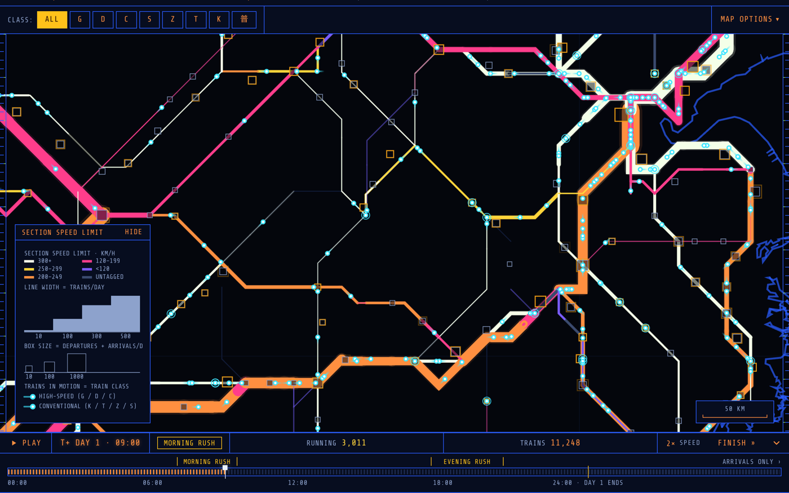

# Octilinear schematic (octi)

The schematic view draws the whole network as a metro-style diagram: every track at
0°, 45° or 90°. The layout is computed offline by LOOM's `octi`
([ad-freiburg/loom](https://github.com/ad-freiburg/loom), Brosi & Bast, EuroVis 2020)
and shipped as one extra asset, `web/public/assets/atlas-v2-octi.json.br`. The asset is a
**geometry twin** of the shared pack, so flows, the 24h train animation, city boxes, the
city panel and the departures all work on it unchanged.

- In the app: `?geom=octi`, or **Map options → Track → Schematic** (shown on the terminal
  skin, `?skin=terminal`). Switching reloads the page, because the geometry is swapped
  before decoding.
- Licence: LOOM is GPL-3.0. It is run as an external offline tool and is never linked
  into or committed to this repo; only its output (layout data) is kept.

| Single national run (detours) | Stitched from 8 tiles (shipped) |
|---|---|
|  |  |



## Rebuild

```sh
brew install cmake glpk boost           # once
scripts/octi/build_loom.sh              # clones LOOM at a pinned commit into output/octi, builds octi
scripts/octi/stitch_pipeline.sh         # ~7 min, ~0.7 GB; writes output/octi/out/stitch_st3_j60.*
W=output/octi
brotli -dc web/public/assets/atlas-v2-national-trains.json.br > $W/national-trains.json
python3 -I scripts/octi/export_layout.py $W/shared.json $W/national-trains.json \
  $W/out/stitch_st3_j60.json $W/out/stitch_st3_j60.map.json $W/atlas-v2-octi.json $W/tiles/t*.side.json
brotli -f -q 11 -o web/public/assets/atlas-v2-octi.json.br $W/atlas-v2-octi.json
```

The work directory is `output/octi` (git-ignored; `OCTI_WORK` overrides). The pipeline is
deterministic: two runs give byte-identical graph, mapping and asset files (same binary,
libraries and arguments). **Rebuild the asset whenever the shared pack changes**: the
client refuses a layout whose `build` stamp or counts differ from the shared pack
(`requireOcti`), and then shows the load error.

## How it works

1. **Partition** (`partition.py`). Eight disjoint rectangular tiles of about 1,500 sections
   each. Cut lines are picked to cross as few sections as possible (98 of 9,106).
2. **Convert** (`convert2.py --partition --tile --tags --loops-as-node --split-parallel 2`).
   The pack's sections become a LOOM input graph per tile. Sections that cross a tile edge
   are cut there. Parallel tracks crossing together share one `cut` node of degree 1, so
   octi never contracts it. Degree-2 chains are pre-contracted exactly as octi would, and
   each chain gets its own line tag `#c<k>`. octi unions line sets on every merge, so the
   tags survive into the output. `--join-paths` (national trains) merges the closest end
   pair of sections that trains run between (throats only between, real gap ≤ 5 km) into one
   node, so octi itself draws the two sides of a station or junction as one point.
3. **Layout** (`best_of_seeds.sh`, `run.sh`). `octi -g 21660` (grid cell 21.66 km in
   web-mercator metres), four runs with different `DETMALLOC_SEED`s, keeping the lowest
   octi score; a winding edge (drawn > 150 km and > 3× its straight line) costs as much as a
   topology violation. octi has no seed of its own: its output depends on heap addresses
   (`std::set<Node*>` ordering). `detmalloc/detmalloc.c` (loaded with
   `DYLD_INSERT_LIBRARIES`) is a fixed-address allocator that makes runs reproducible; the
   seed varies the address order to give distinct, reproducible layouts.
4. **Map back** (`map_sections.py`). For every pack section: the list of
   `(octi edge, f0, f1, dir)` pieces it lies on, in section order, or the node it collapsed
   into. Where octi dropped tags on a parallel merge (about 1% of km), the section is
   recovered by shortest path between its anchored ends. `validate_lines.py` checks the
   result independently against octi's own line propagation.
5. **Stitch** (`stitch.py`). All tiles go into one web-mercator frame; octi keeps
   coordinates roughly geographic. Each cut is closed with a two-leg octilinear connector.
   Where both stubs are 60 km or shorter (76 of 88 cuts), stub + connector + stub become a
   single octilinear edge, and the pieces are remapped onto it. `quality.py` reports
   detours.
6. **Export** (`export_layout.py`, one function per stage; the geometry, the octilinear
   routing and the skeleton are in `octi_geom.py`, which `survey.py` shares). octi's drawing
   is the starting layout. Four general
   rules then compare it with the real track and redraw what disagrees. There are no
   per-place cases; every rule works on the same skeleton: *nodes* (points where sections
   end), *bundles* (sections between the same two nodes whose real tracks share a corridor,
   drawn as one line) and *runs* (chains of bundles through stations, from junction to
   junction or free end).
   1. **Stations.** Section ends that real track joins inside a station are one point:
      ends at the same real point, ends a train path goes between with only throats in
      between, ends linked by throats (through the station's own points), and dangling ends
      at one station (union-find; real gap ≤ 12 km, the longest throat; a group stays under
      12 km wide and never loops a section over 5 km).
   2. **Junctions.** The schematic should be a smooth deformation of the real map. Junction
      positions minimise the difference between each run's drawn and real end-to-end
      offset, weighted by 1 / run length (short runs firm, long runs loose), plus a term
      that holds each junction to octi's point. This puts a branch back where it really
      leaves its line and unfolds a ring that octi drew flat (Hainan). Each junction then
      takes the nearest free point of a lattice of a quarter grid cell (5.4 km), so routes
      coincide, touch or cross cleanly.
   3. **Free ends.** A dead-end branch hangs on one junction, so its free end takes the real
      offset from that junction; branches of branches follow from the trunk outwards
      (octi gives every station a grid cell, which stretched branches). A move that would
      add a wrong meeting is not made.
   4. **Runs.** Every run is drawn as the simplest octilinear route between its two nodes
      that stays within half a grid cell (10.8 km) of its real shape, crosses only what
      it really crosses, and keeps to its real side of every line that really runs
      alongside. Candidates, simplest first: one to three legs, routes along the real
      shape (Douglas-Peucker at 1, 1/2, 1/4 and 1/8 cell, vertices on the lattice, joined
      by ≤ 2 legs), and octi's own route. The real shape is the real track shifted by the
      offsets of the run's two end nodes, blended along the track. The choice is
      lexicographic: never a route more than 3 cells off the real shape when a nearer one
      exists; then the fewest false crossings; then the fewest points on the wrong side
      of (or on top of) a neighbouring line; then the fewest overlaps outside a shared
      corridor (real tracks within ~5 km); then the simplest route that fits, else the
      nearest. So the tolerance is tight where there is room and loosens only where a
      closer route would meet a neighbour wrongly. A run whose best route still has a
      fault also tries the real shape one lattice step to either side. Runs are routed
      against each other's routes in up to four sweeps. Stations along a run are spaced by
      real distance.

      "Side" is sampled from the real track (`octi_geom.side_samples`): every ~5 km along each
      section, for each other track 5 to 33 km away and within 30° of parallel, which side
      it is on. Two lines in one valley are therefore drawn side by side in the real
      order, they swap sides where they really cross, and a line that leaves a corridor
      for a while and rejoins it (Tongwei) is drawn as that excursion on its real side.
      Tracks closer than 5 km are one corridor and may share one drawn line.

   So a line that really runs straight is drawn straight, lines leave a hub on the side
   they really leave it, two lines in one valley are drawn side by side, and any piece
   whose shape disagrees with reality is redrawn from the real track. Then it writes the
   client asset:

| field | content |
|---|---|
| `sections[s]`, `in_sections[s]` | encoded polyline (precision 1e4, lat/lon order, like `g`), same ids as the pack |
| `network` | the drawn section polylines (backdrop only) |
| `throats[t]`, `extra[t]` | station throats of the shared pack and of the national trains' `extra` (≤ 2 octilinear legs between the images of their ends) |
| `station_pt[i]`, `city_pt[i]` | schematic points (`null` keeps the pack point) |
| `fmt`, `build`, `n_*` | checked against the shared pack on load |
| `plane` | `lon-mercdeg`: every point is (lon, web-mercator y in degrees) |

octi is octilinear in web mercator, while the client draws lon/lat on an equirectangular
plane. Writing y as mercator degrees keeps the 45° legs exact on screen (100% of legs over 5 km).
The client projects the coastline outline the same way when on the schematic
(`octiOutline`). Points that are not on the mapping, such as throat ends, the 109
stations that are not skeleton nodes, and the 449 in-sections that differ from their section, go
through one transform: the nearest section within 0.05°, by fraction along that section's
schematic polyline, else the offset of the nearest mapped vertex. Each city sits on one of its
stations: the one at the city's own point (its main station), else the most central one.
Origins (out-map) take their city's point in the client (`octiOrigins`).

## Numbers (shipped layout `st3`, stitched, `-g 21660`, best of 4 seeds, with train-path joins)

| | single national run (`-g 43320`, best of 6) | stitched (shipped) |
|---|---|---|
| sections on an octi line, count / km | 72.1% / 94.4% | 60.3% / 94.6% |
| collapsed to a node (short throat pieces), count / km | 27.8% / 5.6% | 39.6% / 5.4% |
| lost | 12 sections, 0 km (degenerate) | 7 sections, 0 km |
| stations placed by octi | 2,672 of 2,694 | 2,565 as octi nodes; the rest by transform |
| detoured sections (schematic > 3 × geographic + 200 km) | 22 (+8,545 km) | **0** |
| schematic / geographic km | 1.42 | 1.14 |
| topology violations | 190 | 32 (sum of tiles) |
| neighbouring sections that do not meet | (not measured) | 0 |
| train-path breaks (consecutive sections > max(3 km, 3 × real gap) apart) | (not measured) | 9 pairs (601 in octi's own drawing) |
| runs: 1–3 legs / along the real shape (58 of them one step aside) / octi's route / a point (ends under ~3 km apart) | | 954 / 332 / 39 / 27 of 1,352 |
| junctions moved by rule 2, median / 90% / max | | 11 / 24 / 69 km |
| survey: false crossings / breaks / displaced / reversed / squashed | | 0 / 9 / 0 / 0 / 2 (36 / 80 / 8 / 2 / 2 in octi's own drawing) |
| survey: false overlaps, pairs / km | | 39 / 324 (233 / 4,854) |
| survey: wrong side of a line alongside, pairs / share of samples | | 6 / 1.0% (76 / 7.9%) |
| survey: fidelity, mean / 90% distance from the real track after the local shift | | 7.9 / 14.4 km (19.3 / 37.6 km) |
| octilinear legs (plane coords, legs over 5 km) | | 100% |
| runtime | 27 min (6 seeds, 2 parallel) | ~7 min, 0.7 GB |

"Collapsed" sections are a few hundred metres long (station throats, junction stubs);
trains cross them instantly. The earlier "octi drops 54% of sections" figure counted
edges: it was octi merging chains and parallel tracks before drawing, and all of it is
now mapped back. Double track drawn as one line is intended: one corridor, one line.

`--geo-pen` and `--obstacles` were tried on the single national run. Neither removed the
detours, and `--geo-pen` needed 10 GB. Tiling is what makes the finer grid affordable;
the finer grid is what removes the detours.

## Survey

`scripts/octi/survey.py shared.json national-trains.json atlas-v2-octi.json out.json` checks
every section against its real track and clusters the findings by area, weighted by
traffic. Run it after any layout change. It shares its geometry and its reality checks
with the export (`scripts/octi/octi_geom.py`), so the router and the survey measure the same
things:

- **crossing**: section pairs that cross in the schematic but not in reality;
- **overlap**: pairs drawn on top of each other for 3 km or more whose real tracks do not
  share a corridor;
- **side**: pairs that really run alongside each other but are drawn on the wrong side of
  each other for half of the stretch or more (plus the share of all side samples that are
  wrong, or drawn on one line);
- **flipped**, **stretched**, **squashed**, **displaced**: a section pointing the wrong
  way, drawn far too long or short, or far from where its neighbours moved;
- **break**: consecutive sections of a train route drawn apart;
- **fidelity** (one number for the map): the distance between the drawn and the real
  track once the local area shift is removed, per point at the same fraction of the
  section (mean, 90%) and per section as the Hausdorff distance, weighted by length.

## Known limits

- 88 tile seams. Connectors have a median of 16.5 km and a maximum of 56 km; 16 cross
  another edge. They are mostly invisible at the national view; not every seam has been
  inspected up close.
- 32 topology violations remain inside tiles, visible as occasional zigzags or a line
  passing a node it does not serve.
- 9 consecutive-section pairs on train paths are still further apart than in reality
  (joins refused because they would squash a real section into a point or make a group
  wider than 12 km).
- 39 false overlaps remain (324 km in all; 20 of them are a single lattice step, 5 km,
  where two lines leave a hub in the same octant) and 6 pairs on the wrong side.
- Two lines in one corridor are either one drawn line (real tracks within ~5 km) or two
  lines at least one lattice step apart; there is no thinner parallel offset.
- A feature smaller than the lattice (5.4 km) is a point: 27 runs (stubs whose ends are under ~3 km apart and
  four loops of 10 to 15 km at one station complex). Two sections of 25 and 35 km that octi
  itself collapsed into a node stay collapsed.
- Junctions of one station complex are drawn at least one lattice step apart, so hubs are
  a little larger than in reality and lines can jog by one step next to them.

| Before the continuity fix (broken line, hooks) | After |
|---|---|
|  |  |
- The eastern network is dense at national zoom (fine grid).
- On the schematic the scale bar is only indicative (the plane is mercator-stretched and
  the layout is not to scale). The Hainan ferry is drawn as ordinary track, because its
  water-leg rule is geographic.
- The regional layouts (Beijing–Tianjin–Hebei, Yangtze delta, Pearl River delta), which
  are cleaner at close zoom, are not in the app yet. The research viewer swaps them in
  above about 3× zoom; they are independent layouts, so a swap redraws rather than
  refines.

Research history and the regional experiments: `output/octi-spike/` (local, git-ignored)
and `.omc/plans/skins-speed-angular.md`.
