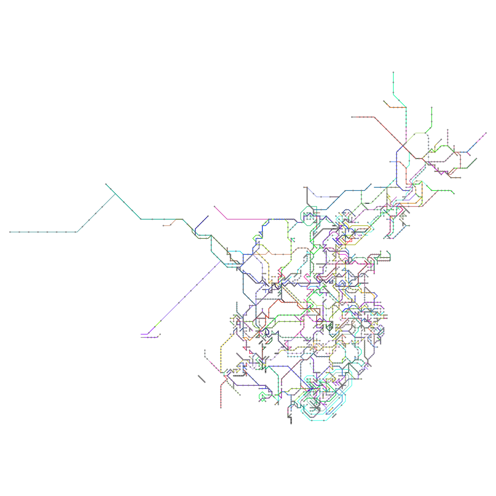
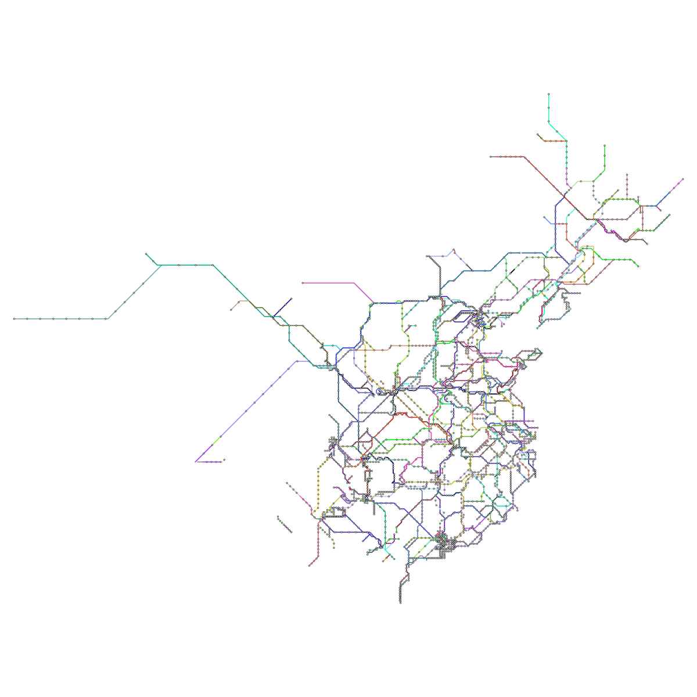
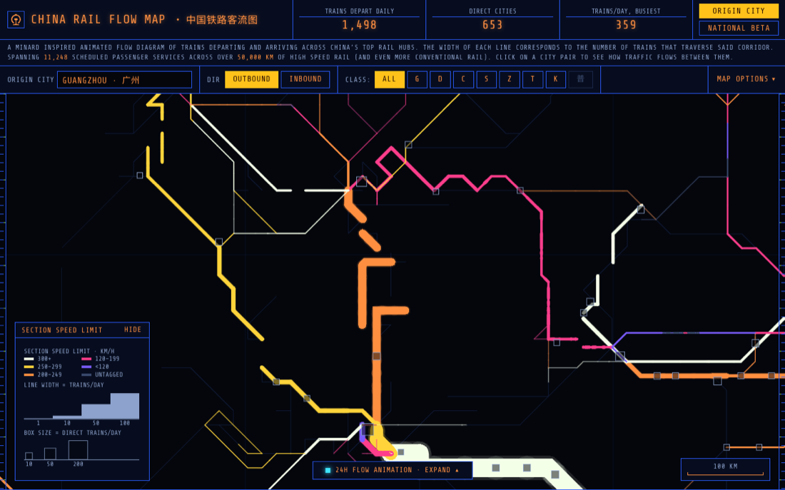
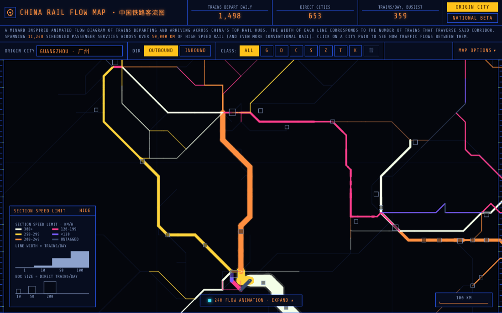

# Octilinear schematic (octi)

The schematic view draws the whole network as a metro-style diagram: every track at
0°, 45° or 90°. The layout is computed offline by LOOM's `octi`
([ad-freiburg/loom](https://github.com/ad-freiburg/loom), Brosi & Bast, EuroVis 2020)
and shipped as one extra asset, `web/public/assets/atlas-v2-octi.json.br`. The asset is a
**geometry twin** of the shared pack, so flows, the 24h train animation, city boxes, the
city panel and the departures all work on it unchanged.

- In the app: `?geom=octi`, or **Map options → Track → Schematic** (shown on the terminal
  skin, `?skin=terminal`). Switching reloads the page, because the geometry is swapped
  before decoding.
- Licence: LOOM is GPL-3.0. It is run as an external offline tool and is never linked
  into or committed to this repo; only its output (layout data) is kept.

| Single national run (detours) | Stitched from 8 tiles (shipped) |
|---|---|
|  |  |


## Rebuild

```sh
brew install cmake glpk boost           # once
scripts/octi/build_loom.sh              # clones LOOM at a pinned commit into output/octi, builds octi
scripts/octi/stitch_pipeline.sh         # ~7 min, ~0.7 GB; writes output/octi/out/stitch_st3_j60.*
W=output/octi
brotli -dc web/public/assets/atlas-v2-national-trains.json.br > $W/national-trains.json
python3 -I scripts/octi/export_layout.py $W/shared.json $W/national-trains.json \
  $W/out/stitch_st3_j60.json $W/out/stitch_st3_j60.map.json $W/atlas-v2-octi.json $W/tiles/t*.side.json
brotli -f -q 11 -o web/public/assets/atlas-v2-octi.json.br $W/atlas-v2-octi.json
```

The work directory is `output/octi` (git-ignored; `OCTI_WORK` overrides). The pipeline is
deterministic: two runs give byte-identical graph, mapping and asset files (same binary,
libraries and arguments). **Rebuild the asset whenever the shared pack changes**: the
client refuses a layout whose `build` stamp or counts differ from the shared pack
(`requireOcti`), and then shows the load error.

## How it works

1. **Partition** (`partition.py`). Eight disjoint rectangular tiles of about 1,500 sections
   each. Cut lines are picked to cross as few sections as possible (98 of 9,106).
2. **Convert** (`convert2.py --partition --tile --tags --loops-as-node --split-parallel 2`).
   The pack's sections become a LOOM input graph per tile. Sections that cross a tile edge
   are cut there. Parallel tracks crossing together share one `cut` node of degree 1, so
   octi never contracts it. Degree-2 chains are pre-contracted exactly as octi would, and
   each chain gets its own line tag `#c<k>`. octi unions line sets on every merge, so the
   tags survive into the output. `--join-paths` (national trains) merges the closest end
   pair of sections that trains run between (throats only between, real gap ≤ 5 km) into one
   node, so octi itself draws the two sides of a station or junction as one point.
3. **Layout** (`best_of_seeds.sh`, `run.sh`). `octi -g 21660` (grid cell 21.66 km in
   web-mercator metres), four runs with different `DETMALLOC_SEED`s, keeping the lowest
   octi score; a winding edge (drawn > 150 km and > 3× its straight line) costs as much as a
   topology violation. octi has no seed of its own: its output depends on heap addresses
   (`std::set<Node*>` ordering). `detmalloc/detmalloc.c` (loaded with
   `DYLD_INSERT_LIBRARIES`) is a fixed-address allocator that makes runs reproducible; the
   seed varies the address order to give distinct, reproducible layouts.
4. **Map back** (`map_sections.py`). For every pack section: the list of
   `(octi edge, f0, f1, dir)` pieces it lies on, in section order, or the node it collapsed
   into. Where octi dropped tags on a parallel merge (about 1% of km), the section is
   recovered by shortest path between its anchored ends. `validate_lines.py` checks the
   result independently against octi's own line propagation.
5. **Stitch** (`stitch.py`). All tiles go into one web-mercator frame; octi keeps
   coordinates roughly geographic. Each cut is closed with a two-leg octilinear connector.
   Where both stubs are 60 km or shorter (76 of 88 cuts), stub + connector + stub become a
   single octilinear edge, and the pieces are remapped onto it. `quality.py` reports
   detours.
6. **Export** (`export_layout.py`). A continuity pass first: section ends that trains run
   between (real gap ≤ 12 km, the longest throat), ends at the same real point, and dangling
   ends at one station are grouped (union-find; a group stays under 12 km wide and never loops
   a section over 5 km). Each group gets one schematic point, and moved ends get a short
   octilinear leg. A cleanup then erases loops, out-and-back spikes and straight-through
   vertices, and redraws any section still longer than 1.6× its octilinear end-to-end distance
   (+ 0.05°) as a ≤ 2-leg route; ends never move. Last, runs between junctions are
   straightened: parallel sections between the same two nodes (two lines sharing every
   station, a "ladder") form one bundle, and each chain of bundles through degree-2 nodes is
   redrawn as the 1- or 2-leg octilinear route between its junctions, unless that would cross
   more lines than the current drawing; its stations are spaced by real distance. Then it
   writes the client asset:

| field | content |
|---|---|
| `sections[s]`, `in_sections[s]` | encoded polyline (precision 1e4, lat/lon order, like `g`), same ids as the pack |
| `network` | the drawn section polylines (backdrop only) |
| `throats[t]`, `extra[t]` | station throats of the shared pack and of the national trains' `extra` |
| `station_pt[i]`, `city_pt[i]` | schematic points (`null` keeps the pack point) |
| `fmt`, `build`, `n_*` | checked against the shared pack on load |
| `plane` | `lon-mercdeg`: every point is (lon, web-mercator y in degrees) |

octi is octilinear in web mercator, while the client draws lon/lat on an equirectangular
plane. Writing y as mercator degrees keeps the 45° legs exact on screen (99.9% of legs).
The client projects the coastline outline the same way when on the schematic
(`octiOutline`). Points that are not on the mapping, such as throat ends, the 109
stations octi did not place, and the 449 in-sections that differ from their section, go
through one transform: the nearest section within 0.05°, by fraction along that section's
schematic polyline, else the offset of the nearest mapped vertex. Cities move by the mean
offset of their stations.

## Numbers (shipped layout `st3`, stitched, `-g 21660`, best of 4 seeds, with train-path joins)

| | single national run (`-g 43320`, best of 6) | stitched (shipped) |
|---|---|---|
| sections on an octi line, count / km | 72.1% / 94.4% | 60.3% / 94.6% |
| collapsed to a node (short throat pieces), count / km | 27.8% / 5.6% | 39.6% / 5.4% |
| lost | 12 sections, 0 km (degenerate) | 7 sections, 0 km |
| stations placed by octi | 2,672 of 2,694 | 2,565 as octi nodes; the rest by transform |
| detoured sections (schematic > 3 × geographic + 200 km) | 22 (+8,545 km) | **0** |
| schematic / geographic km | 1.42 | 1.14 |
| topology violations | 190 | 32 (sum of tiles) |
| neighbouring sections that do not meet | (not measured) | 0 |
| train-path breaks (consecutive sections > max(3 km, 3 × real gap) apart) | (not measured) | 98 pairs (601 before the joins) |
| runs between junctions straightened | | 668 (3,423 sections); 70 kept to avoid new crossings |
| octilinear legs (plane coords) | | 99.95% |
| runtime | 27 min (6 seeds, 2 parallel) | ~7 min, 0.7 GB |

"Collapsed" sections are a few hundred metres long (station throats, junction stubs);
trains cross them instantly. The earlier "octi drops 54% of sections" figure counted
edges: it was octi merging chains and parallel tracks before drawing, and all of it is
now mapped back. Double track drawn as one line is intended: one corridor, one line.

`--geo-pen` and `--obstacles` were tried on the single national run. Neither removed the
detours, and `--geo-pen` needed 10 GB. Tiling is what makes the finer grid affordable;
the finer grid is what removes the detours.

## Known limits

- 88 tile seams. Connectors have a median of 16.5 km and a maximum of 56 km; 16 cross
  another edge. They are mostly invisible at the national view; not every seam has been
  inspected up close.
- 32 topology violations remain inside tiles, visible as occasional zigzags or a line
  passing a node it does not serve.
- 98 consecutive-section pairs on train paths are still further apart than in reality:
  real gaps over 15 km, or joins refused because they would squash a real section into a
  point or make a group wider than 12 km.
- Junctions stay where octi put them, so a line can still jog at 45° where another line
  branches off. These read as octi drawing
  the track longer than it is, not as hooks.

| Before the continuity fix (broken line, hooks) | After |
|---|---|
|  |  |
- The eastern network is dense at national zoom (fine grid).
- On the schematic the scale bar is only indicative (the plane is mercator-stretched and
  the layout is not to scale). The Hainan ferry is drawn as ordinary track, because its
  water-leg rule is geographic.
- The regional layouts (Beijing–Tianjin–Hebei, Yangtze delta, Pearl River delta), which
  are cleaner at close zoom, are not in the app yet. The research viewer swaps them in
  above about 3× zoom; they are independent layouts, so a swap redraws rather than
  refines.

Research history and the regional experiments: `output/octi-spike/` (local, git-ignored)
and `.omc/plans/skins-speed-angular.md`.
